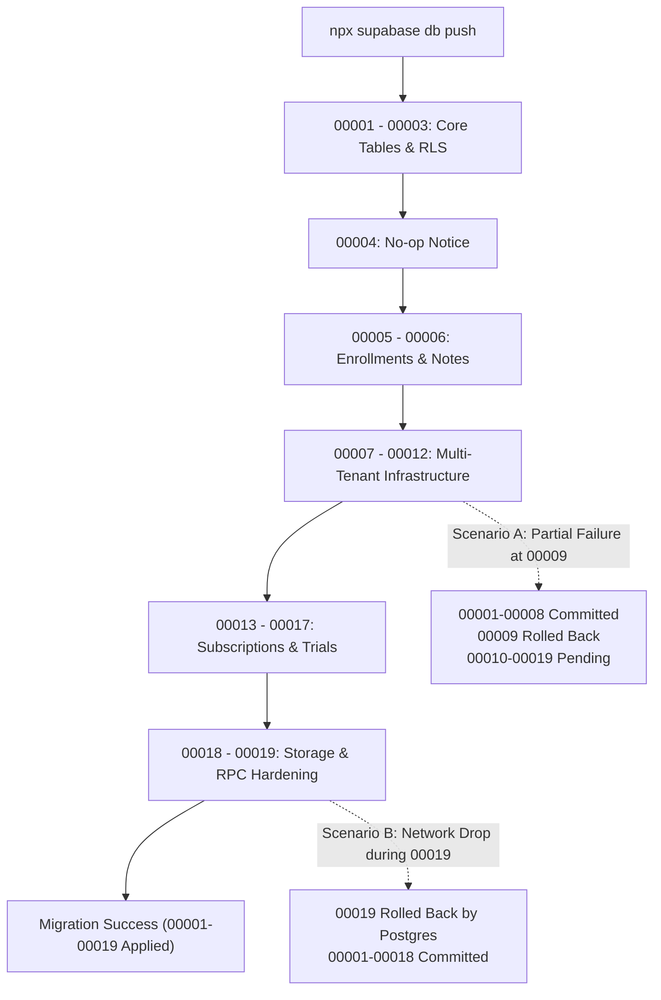
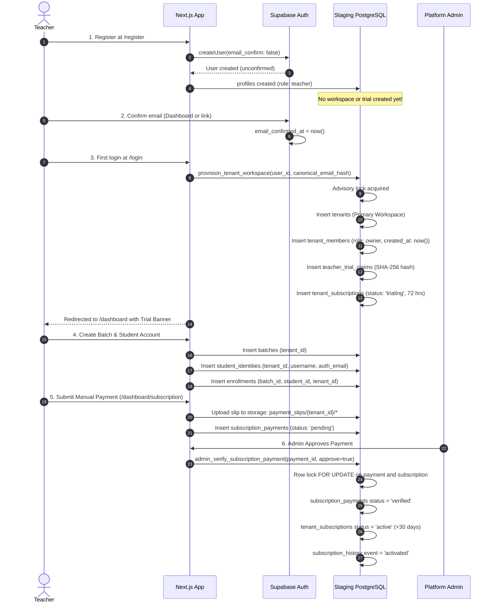

# EDVORA — PHASE 3C.6: STAGING MIGRATION EXECUTION READINESS REPORT

**Readiness Date:** 2026-11-25  
**Target Environment:** Staging (`edvora-staging` / `voyypkysddyrjuqimzya`, `ap-northeast-1`)  
**Protected Environment:** Development (`edvora` / `sauphnaxchcouqslflsl`) — Detached & Untouched  
**Audit Scope:** Migrations `00001` through `00019`, Transaction Safety, Failure Scenarios, Recovery Playbooks, SQL Verification Queries, and End-to-End Validation Protocol  
**Operating Mode:** Strictly Read-Only (Zero Migrations Applied, Zero Data Mutated)  

---

## 1. Executive Summary & Final Verdict

### Final Verdict: **READY FOR STAGING MIGRATION**

The Edvora multi-tenant database migration suite (`00001_create_tables.sql` through `00019_rpc_security_and_storage_hardening.sql`) is fully prepared, hardened, and verified for staging execution:
1. **Target Link Confirmed:** The local Supabase CLI is verified linked exclusively to `voyypkysddyrjuqimzya` (`linked: true`). The production/development project `sauphnaxchcouqslflsl` is completely unlinked (`linked: false`) and safe.
2. **Critical Corrections Applied & Validated:**
   - `00004_seed_teacher.sql` is a safe, valid no-op `DO` block (zero UUID cast errors).
   - `00018` and `00019` consistently reference physical column `created_at` (zero `joined_at` references in the codebase).
   - Static test suite passed: TypeScript (0 errors), ESLint (0 errors), SaaS test suite (74/74 passed), Next.js production build (33 routes compiled).
3. **Transaction Safety Verified:** All 19 migration files use standard transactional DDL statements with zero non-transactional statements (`CONCURRENTLY`, `VACUUM`). Every file executes as an atomic transaction.
4. **Sole Remaining Operational Step:** Supplying the staging database password (`$env:SUPABASE_DB_PASSWORD` or CLI interactive prompt) when executing `npx supabase db push`.

---

## 2. Transactional DDL & Failure Mode Analysis

### 2.1 Transactional DDL Audit across Migrations 00001–00019
In PostgreSQL, DDL operations (`CREATE TABLE`, `ALTER TABLE`, `CREATE INDEX`, `CREATE FUNCTION`, `CREATE POLICY`, `ALTER TABLE ENABLE RLS`) are fully transactional. Supabase CLI wraps each migration file in a transaction block (`BEGIN ... COMMIT`).

| Migration Range | DDL Operations Used | Transaction Safety | Notes |
| :--- | :--- | :---: | :--- |
| `00001`–`00003` | `CREATE EXTENSION`, `CREATE TABLE`, `ENABLE RLS`, `CREATE POLICY`, `CREATE FUNCTION` | **ATOMIC** | All statements roll back if any statement fails. |
| `00004` | `DO $$ BEGIN RAISE NOTICE ...; END $$;` | **ATOMIC** | Safe no-op execution (< 1ms). |
| `00005`–`00006` | `CREATE TABLE`, `CREATE INDEX`, `DROP COLUMN`, `INSERT INTO storage.buckets` | **ATOMIC** | Standard transactional DDL & DML. |
| `00007`–`00012` | Multi-tenant core, composite unique/FKs, `SECURITY DEFINER` functions, storage RLS | **ATOMIC** | Composite constraints in 00009 are ordered strictly before composite FKs. |
| `00013`–`00017` | Subscription catalog, quota triggers, rate limits, 72-hr trial | **ATOMIC** | Trigger creations and table constraints roll back atomically on error. |
| `00018`–`00019` | Bucket creation, RPC hardening, row-level locking triggers | **ATOMIC** | Stored procedures compile and commit inside migration transaction. |

**Non-Transactional Statement Audit:**
- Search for `CONCURRENTLY`: **0 occurrences found.**
- Search for `VACUUM`: **0 occurrences found.**
- **Conclusion:** There are **zero non-transactional operations**. If any statement within a migration file fails, PostgreSQL rolls back that specific file completely.

---

### 2.2 Potential Partial-Failure Scenarios



1. **Scenario A: Failure at Inter-Migration Boundary (e.g. at migration 00009):**
   - *Behavior:* Migrations `00001` through `00008` have already committed and are recorded in `supabase_migrations.schema_migrations`. Migration `00009` aborts and rolls back cleanly.
   - *Database State:* The database remains in a consistent state corresponding to migration `00008`. No partial statements from `00009` persist.
2. **Scenario B: Connection Drop During Execution:**
   - *Behavior:* The active transaction is aborted by PostgreSQL's backend connection termination. The migration being applied is rolled back.
   - *Database State:* `schema_migrations` reflects only the migrations that completed prior to the disconnect.
3. **Scenario C: Incorrect Database Password Supplied:**
   - *Behavior:* Connection is rejected before any migration executes (`FATAL: password authentication failed for user "postgres"`).
   - *Database State:* Database remains completely untouched (0 migrations applied).

---

## 3. Post-Failure Inspection & Non-Destructive Recovery Playbook

If a failure occurs during execution, follow this non-destructive diagnosis and recovery protocol. **Never run `supabase db reset` or drop schemas.**

### 3.1 Inspecting Migration State Post-Failure

1. **Query Remote Migration Ledger:**
   ```sql
   SELECT version, inserted_at 
   FROM supabase_migrations.schema_migrations 
   ORDER BY version ASC;
   ```
2. **Inspect Applied Tables:**
   ```sql
   SELECT table_schema, table_name 
   FROM information_schema.tables 
   WHERE table_schema = 'public' 
   ORDER BY table_name;
   ```
3. **Inspect Active Functions:**
   ```sql
   SELECT routine_name, routine_type, security_type
   FROM information_schema.routines
   WHERE routine_schema = 'public'
   ORDER BY routine_name;
   ```

### 3.2 Non-Destructive Recovery Steps

1. **Do Not Reset the Database:**
   Running `db reset` destroys all existing data and resets local migration tracking. Avoid it.
2. **Identify the Failing Migration File:**
   The error message will report the exact migration file and SQL line number that failed (e.g. `00010_tenant_auth_functions.sql:45`).
3. **Correct the Failing File Locally:**
   Apply the targeted correction to the specific migration file in `supabase/migrations/`.
4. **Re-run Migration Push:**
   Execute:
   ```bash
   npx supabase db push
   ```
   Supabase CLI automatically compares local files against `supabase_migrations.schema_migrations`, skips already-applied migrations, and resumes execution seamlessly from the first unapplied file.
5. **Handling Ledger Inconsistencies (Emergency Recovery Only):**
   If a migration was manually applied in the SQL editor:
   ```bash
   npx supabase migration repair --status applied <version>
   ```
   If a migration needs to be re-run after manual cleanup:
   ```bash
   npx supabase migration repair --status reverted <version>
   ```

---

## 4. Staging Prerequisites & Configuration Matrix

Before executing migrations on `edvora-staging` (`voyypkysddyrjuqimzya`):

| Configuration Item | Required Setting | Action / Purpose |
| :--- | :--- | :--- |
| **CLI Target Project** | `voyypkysddyrjuqimzya` | Confirmed in `supabase/.temp/project-ref`. |
| **CLI Authentication** | Personal Access Token | Exported in shell via `$env:SUPABASE_ACCESS_TOKEN`. |
| **Database Password** | Staging DB Password | Supplied when prompted by `supabase db push` or via `$env:SUPABASE_DB_PASSWORD`. |
| **Supabase Auth Provider** | Email Provider Enabled | *Authentication -> Providers -> Email*: **Enabled**. |
| **Email Confirmation** | **Confirm email = ON** | *Authentication -> Providers -> Email*: **Enabled**. Required for `provision_tenant_workspace()` verification check. |
| **Auth Redirect URLs** | `http://localhost:3000/**` | *Authentication -> URL Configuration*: Add local development and Vercel staging preview URLs. |
| **Zero-Budget Email Strategy** | Supabase Free Built-in | Max 3 confirmation emails/hour. For testing, confirm users via Supabase Dashboard (*Authentication -> Users -> Confirm User*) or configure free SMTP (e.g. Resend free 100/day tier) at $0 cost. |
| **Storage Extension** | Supabase Storage Service | Pre-installed. Migrations `00006` and `00018` insert buckets `notes` and `payment_slips`. |
| **Staging Environment File** | `.env.staging` | Configured with staging URL and anon key; strictly ignored by `.gitignore`. |

---

## 5. Post-Migration SQL Verification Suite

Execute these read-only SQL queries in the Supabase Dashboard SQL Editor (or via CLI) immediately after `supabase db push` to verify database health across all 8 security domains.

### Domain 1: Tables and Columns Verification
```sql
-- Verify all 15 core application tables exist in public schema
SELECT table_name, 
       (SELECT count(*) FROM information_schema.columns c WHERE c.table_name = t.table_name AND c.table_schema = 'public') AS column_count
FROM information_schema.tables t
WHERE table_schema = 'public'
  AND table_type = 'BASE TABLE'
ORDER BY table_name;
-- EXPECTED: 15 tables (announcement_batches, announcements, auth_rate_limits, batches, enrollments,
-- lesson_batches, lessons, note_batches, notes, platform_admins, profiles, student_identities,
-- subscription_history, subscription_payments, subscription_plans, tenant_members, tenant_subscriptions, tenants)
```

### Domain 2: Foreign Keys & Composite Integrity Verification
```sql
-- Verify composite foreign keys on junction tables enforcing tenant isolation
SELECT conname AS constraint_name, 
       conrelid::regclass AS table_name, 
       confrelid::regclass AS foreign_table
FROM pg_constraint
WHERE conname IN (
  'fk_lb_lesson_tenant', 'fk_lb_batch_tenant',
  'fk_nb_note_tenant', 'fk_nb_batch_tenant',
  'fk_ab_announcement_tenant', 'fk_ab_batch_tenant',
  'fk_enrollments_batch_tenant', 'fk_enrollments_student_identity'
)
ORDER BY table_name;
-- EXPECTED: 8 composite foreign key constraints.
```

### Domain 3: Row Level Security (RLS) Status
```sql
-- Verify RLS is enabled on all public application tables
SELECT relname AS table_name, relrowsecurity AS rls_enabled
FROM pg_class
JOIN pg_namespace ON pg_namespace.oid = pg_class.relnamespace
WHERE pg_namespace.nspname = 'public'
  AND pg_class.relkind = 'r'
  AND relname NOT LIKE 'pg_%'
ORDER BY relname;
-- EXPECTED: rls_enabled = true for all tables.
```

### Domain 4: RLS Policies Verification
```sql
-- Verify RLS policy counts per table
SELECT tablename, count(*) AS policy_count
FROM pg_policies
WHERE schemaname = 'public'
GROUP BY tablename
ORDER BY tablename;
-- EXPECTED: Active policies on tenants, tenant_members, student_identities, batches, lessons,
-- notes, announcements, enrollments, profiles, subscription_plans, tenant_subscriptions, subscription_payments.
```

### Domain 5: SECURITY DEFINER Functions & Fixed Search Path Verification
```sql
-- Verify all critical security functions have SECURITY DEFINER and SET search_path = ''
SELECT routine_name, 
       prosecdef AS is_security_definer,
       proconfig AS search_path_config
FROM information_schema.routines r
JOIN pg_proc p ON p.proname = r.routine_name
JOIN pg_namespace n ON n.oid = p.pronamespace
WHERE n.nspname = 'public'
  AND routine_name IN (
    'get_auth_tenant_ids', 'get_my_tenant_role', 'has_tenant_role',
    'is_tenant_student', 'is_enrolled_in_tenant_batch', 'is_platform_admin',
    'is_tenant_subscription_active', 'get_tenant_quota_summary',
    'admin_verify_subscription_payment', 'enforce_tenant_student_quota',
    'enforce_active_subscription_for_mutations', 'check_rate_limit',
    'record_failed_rate_limit_attempt', 'reset_rate_limit',
    'provision_tenant_workspace'
  )
ORDER BY routine_name;
-- EXPECTED: is_security_definer = true, search_path_config contains 'search_path=' for all functions.
```

### Domain 6: Function EXECUTE Privileges Verification
```sql
-- Verify provision_tenant_workspace and rate-limiting RPCs are strictly granted to service_role only
SELECT routine_name,
       has_function_privilege('anon', format('public.%I(%s)', p.proname, oidvectortypes(p.proargtypes)), 'EXECUTE') AS anon_can_exec,
       has_function_privilege('authenticated', format('public.%I(%s)', p.proname, oidvectortypes(p.proargtypes)), 'EXECUTE') AS auth_can_exec,
       has_function_privilege('service_role', format('public.%I(%s)', p.proname, oidvectortypes(p.proargtypes)), 'EXECUTE') AS service_can_exec
FROM pg_proc p
JOIN pg_namespace n ON n.oid = p.pronamespace
JOIN information_schema.routines r ON r.routine_name = p.proname
WHERE n.nspname = 'public'
  AND proname IN ('provision_tenant_workspace', 'check_rate_limit', 'record_failed_rate_limit_attempt', 'reset_rate_limit');
-- EXPECTED: anon_can_exec = false, auth_can_exec = false, service_can_exec = true.
```

### Domain 7: Private Storage Buckets Verification
```sql
-- Verify notes and payment_slips buckets exist and are strictly private
SELECT id, name, public, file_size_limit, allowed_mime_types
FROM storage.buckets
WHERE id IN ('notes', 'payment_slips')
ORDER BY id;
-- EXPECTED:
-- 'notes': public = false
-- 'payment_slips': public = false, file_size_limit = 5242880 (5MB), allowed_mime_types = {'image/jpeg','image/png','application/pdf'}
```

### Domain 8: Subscription Plans & Pricing Catalog Verification
```sql
-- Verify approved commercial pricing tiers exist
SELECT code, name, price_lkr_monthly, price_lkr_annual, max_students, max_storage_bytes, is_active
FROM public.subscription_plans
ORDER BY sort_order;
-- EXPECTED:
-- 'starter': 2600.00 LKR/mo, annual = NULL, 30 students, 2GB
-- 'growth':  5000.00 LKR/mo, annual = NULL, 100 students, 10GB
-- 'pro':     8000.00 LKR/mo, annual = NULL, 300 students, 50GB
```

---

## 6. End-to-End Staging Test Sequence

After running `supabase db push` and executing the verification suite above, perform this functional end-to-end staging test:



### Detailed Execution Protocol:

1. **Test 1: Teacher Registration & Email Gatekeeping:**
   - Navigate to `http://localhost:3000/register` (connected to staging via `.env.staging` / `.env.local`).
   - Register a new teacher account: `test.teacher@example.com`, Password: `TestPassword123!`, Workspace: `Apex Science Academy`.
   - Verify: Redirected to `/register/success`.
   - Verify in DB: `auth.users` row exists with `email_confirmed_at IS NULL`.
   - Verify in DB: Query `public.tenants` — **0 rows exist** for this user. Trial has **not** started.
2. **Test 2: Email Confirmation & Atomic Workspace Provisioning:**
   - In Supabase Dashboard (*Authentication -> Users*), click "Confirm User" (or click confirmation link).
   - Log in at `/login` with `test.teacher@example.com`.
   - Verify: `provision_tenant_workspace()` is triggered via Server Action.
   - Verify in DB:
     - 1 row in `public.tenants` (`slug = 'apex-science-academy'`).
     - 1 row in `public.tenant_members` (`role = 'owner'`, `created_at` populated).
     - 1 row in `public.teacher_trial_claims` (`normalized_email_hash = sha256('test.teacher@example.com')`).
     - 1 row in `public.tenant_subscriptions` (`status = 'trialing'`, `trial_ends_at = clock_timestamp() + 72 hours`).
   - Verify UI: Teacher dashboard displays active trial countdown pill (`TrialBanner.tsx`).
3. **Test 3: Trial Duplicate Abuse Prevention:**
   - Register a second teacher using an alias of the same canonical address: `test.teacher+alias@example.com`.
   - Confirm email and log in.
   - Verify in DB: Workspace is provisioned with `status = 'expired'` and `is_trial = false` because the canonical email hash matches the existing claim.
4. **Test 4: Student Account Provisioning & Isolation:**
   - As first teacher, create a batch: "2027 Physics Batch".
   - Create student account: Username `nimal`, Name `Nimal Perera`.
   - Open a private browsing session and log in at `/login` as `nimal`.
   - Verify: Student lands on `/home` and sees "2027 Physics Batch".
   - Verify: Student cannot access `/dashboard` (redirected to `/home`).
   - Verify: Querying lessons or notes from another tenant yields 0 rows via RLS.
5. **Test 5: Manual Bank Transfer Payment Submission:**
   - As teacher, navigate to `/dashboard/subscription`.
   - Select Starter plan (LKR 2,600.00 / month), attach a valid sample image or PDF (< 5 MB).
   - Submit payment slip.
   - Verify: File uploaded to private bucket `payment_slips/{tenant_id}/*`.
   - Verify: 1 row in `public.subscription_payments` with `status = 'pending'`.
6. **Test 6: Platform Super-Admin Verification & Activation:**
   - In Supabase SQL Editor, grant platform admin status to a test user:
     ```sql
     INSERT INTO public.platform_admins (user_id, notes) 
     VALUES ('<ADMIN_USER_UUID>', 'Staging Super Admin');
     ```
   - Call payment approval via Server Action or SQL procedure:
     ```sql
     SELECT public.admin_verify_subscription_payment('<PAYMENT_UUID>', true, NULL, 30);
     ```
   - Verify in DB:
     - `subscription_payments.status` is `'verified'`.
     - `tenant_subscriptions.status` is `'active'`.
     - `tenant_subscriptions.current_period_end` is `now() + 30 days`.
     - `subscription_history` records event `'activated'`.
   - Verify UI: Teacher dashboard refreshes and displays active subscription badge.

---

## 7. Migration Execution Command

When you are ready to apply all 19 migrations to `edvora-staging` (`voyypkysddyrjuqimzya`), run:

```bash
npx supabase db push
```

*(Enter the database password for `edvora-staging` when prompted. Never enter the development database password).*

---

## 8. Remaining Blockers Summary

- **Zero code, schema, or configuration blockers remain.**
- **Operational Requirement:** The user must enter the staging database password during `supabase db push`.

The staging migration execution checklist is complete and certified.
