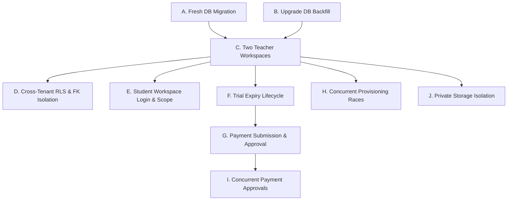

# Edvora — Phase 3C: Database Integration Test Matrix
## Staging Integration Test Plan & Critical Security Verification Suite

**Document Version:** 1.0.0  
**Test Protocol Date:** 2026-11-25  
**Author:** Principal Database & SaaS Security Architect  
**Classification:** Staging Database Validation Specification  
**Status:** **PREPARED FOR DISPOSABLE STAGING DATABASE EXECUTION**  
**Execution Constraint:** Strictly unexecuted against production project `sauphnaxchcouqslflsl`.

---

## 1. Executive Summary & Test Methodology Classification

This document specifies the end-to-end integration and security test suite designed for execution on a **disposable staging PostgreSQL database**.

### Test Methodology Distinction
To ensure absolute technical honesty and compliance with security audit standards, test classifications are strictly categorized:

| Category | Execution Environment | Capabilities | Limitations |
|---|---|---|---|
| **Category 1: Mocked Unit / Integration Contract Tests** | Local Node.js test runner (`npm run test:saas`) | Validates TypeScript schemas, authorization matrices, Server Action handlers, and SQL migration text contracts. | Does not execute real SQL transactions or test PostgreSQL locking primitives against a live database engine. |
| **Category 2: Real PostgreSQL Staging Integration Tests** | Disposable Staging PostgreSQL Database | Exercises real PostgreSQL triggers, composite foreign keys, RLS policies, advisory locks, and row locks (`FOR UPDATE`). | Requires an isolated, disposable database with applied migrations `00007`–`00019`. |
| **Category 3: Multi-Client Concurrency Stress Tests** | Real PostgreSQL with multi-connection harness | Tests actual race conditions, transactional advisory lock serialization, and simultaneous payment approval attempts. | Requires concurrent database connection pooling on staging. |

---

## 2. Staging Integration Test Plan (Scenarios A through J)



---

### Scenario A: Fresh Database Migration Test
- **Objective:** Verify that migrations `00001` through `00019` apply completely from an empty database without dependencies errors.
- **Preconditions:** Clean PostgreSQL database with zero tables.
- **Execution Steps:**
  1. Apply base migrations `00001`–`00006`.
  2. Apply multi-tenant migrations `00007`–`00019` sequentially.
- **Pass Criteria:**
  - All 19 migration scripts return exit code 0.
  - Table `supabase_migrations.schema_migrations` contains all 19 entries.
  - `public.subscription_plans` is seeded with `starter` (LKR 2,600), `growth` (LKR 5,000), `pro` (LKR 8,000).
  - Storage bucket `payment_slips` has `public = false`, `file_size_limit = 5242880`.

---

### Scenario B: Existing Single-Teacher Database Upgrade Test
- **Objective:** Verify that an existing Phase 1/2 single-teacher database upgrades seamlessly without data loss.
- **Preconditions:** Database with Phase 1/2 schema (`00001`–`00006`) containing 1 teacher profile, 3 batches, 5 lessons, 10 student profiles, and 15 enrollments.
- **Execution Steps:**
  1. Apply migrations `00007` through `00019`.
  2. Query `public.tenants WHERE slug = 'default-workspace'`.
  3. Query `public.student_identities WHERE tenant_id = <default_tenant_id>`.
  4. Query `public.batches`, `public.lessons`, `public.enrollments` for `tenant_id`.
- **Pass Criteria:**
  - `default-workspace` is created with `owner_id = <teacher_id>`.
  - All 10 student profiles are backfilled into `public.student_identities` mapped to their existing auth emails.
  - All batches, lessons, notes, and enrollments have `tenant_id = <default_tenant_id>` with zero NULL columns.
  - Existing student logins can authenticate against `default-workspace`.

---

### Scenario C: Two Independent Teacher Workspaces
- **Objective:** Provision two separate tuition workspaces with distinct owners and verified staff.
- **Setup:**
  - **Tenant A:** "Alpha Physics Academy" (`slug = 'alpha-physics'`), Owner = Teacher A (`teacher.a@gmail.com`).
  - **Tenant B:** "Beta Chemistry Hub" (`slug = 'beta-chem'`), Owner = Teacher B (`teacher.b@gmail.com`).
- **Execution Steps:**
  1. Execute `public.provision_tenant_workspace()` for Teacher A.
  2. Execute `public.provision_tenant_workspace()` for Teacher B.
- **Pass Criteria:**
  - Two distinct tenant rows created in `public.tenants`.
  - Both workspaces initialized with `status = 'trialing'`, `is_trial = true`, `trial_ends_at = clock_timestamp() + 72 hours`.
  - Teacher A is registered as `owner` of Tenant A; Teacher B as `owner` of Tenant B.
  - Neither teacher holds any membership in the opposite workspace.

---

### Scenario D: Cross-Tenant Read/Write Isolation Tests
- **Objective:** Verify database-level RLS policies and composite foreign keys physically block cross-tenant leakage.
- **Execution Steps:**
  1. Teacher A creates Batch A (`name = '2026 Advanced'`) in Tenant A.
  2. Teacher B attempts to query `public.batches` while authenticated as Teacher B.
  3. Teacher A attempts to insert a lesson into Batch B using `(lesson_id, tenant_a_id)` referencing `(batch_b_id, tenant_a_id)`.
  4. Teacher A attempts to directly UPDATE Batch B's record in `public.batches`.
- **Pass Criteria:**
  - Step 2: Query returns 0 rows for Batch A (RLS blocks reading other tenants' batches).
  - Step 3: PostgreSQL raises composite foreign key violation error `fk_lb_batch_tenant` (violates composite key constraint).
  - Step 4: UPDATE statement affects 0 rows (RLS blocks mutation).

---

### Scenario E: Student Workspace Login & Scope
- **Objective:** Verify student usernames are scoped to tenants, allowing identical usernames across distinct tuition centers.
- **Execution Steps:**
  1. Teacher A registers student with username `"kasun"` in Tenant A (`auth_email = 'kasun.a@edvora.internal'`).
  2. Teacher B registers student with identical username `"kasun"` in Tenant B (`auth_email = 'kasun.b@edvora.internal'`).
  3. Student A logs in with `workspace = 'alpha-physics'`, `username = 'kasun'`, `password = 'Pass123!'`.
  4. Student A attempts to access Tenant B's workspace.
- **Pass Criteria:**
  - Both `"kasun"` accounts are successfully created without unique constraint collisions (enforced by `UNIQUE(tenant_id, lower(username))`).
  - Student A resolves strictly to `kasun.a@edvora.internal` and receives access to Tenant A's enrolled batches.
  - Student A is blocked from Tenant B with `NO_WORKSPACES` / `403 Forbidden`.

---

### Scenario F: Trial Expiration Lifecycle
- **Objective:** Verify that workspace mutation and student content access are halted upon trial termination.
- **Execution Steps:**
  1. For Tenant A, artificially set `trial_ends_at = clock_timestamp() - interval '1 minute'` in `public.tenant_subscriptions`.
  2. Teacher A attempts to create a new lesson via `actions/lessons.ts:createLesson()`.
  3. Enrolled Student A attempts to fetch lesson content at `/home/lessons`.
- **Pass Criteria:**
  - Step 2: Server Action rejects mutation with error `SUBSCRIPTION_EXPIRED` (trigger `enforce_active_subscription_for_mutations` raises exception).
  - Step 3: Student interface displays the inactive workspace banner shielding lesson video links.

---

### Scenario G: Payment Submission & Approval Tests
- **Objective:** Verify the complete manual bank transfer commercial activation flow.
- **Execution Steps:**
  1. Teacher A submits payment proof for `starter` plan (LKR 2,600 monthly) with reference number `"TXN-998877"`.
  2. Verify tenant subscription transitions to `status = 'pending_payment'`.
  3. Attempt teacher mutations while `status = 'pending_payment'`.
  4. Platform administrator invokes `public.admin_verify_subscription_payment(payment_id, true, null, 30)`.
- **Pass Criteria:**
  - Step 2: `subscription_payments` record created with `amount_lkr = 2600.00` strictly bound to catalog price.
  - Step 3: Teacher mutations remain blocked while in `pending_payment` state.
  - Step 4: Subscription transitions to `status = 'active'`, `current_period_end = clock_timestamp() + 30 days`. Teacher mutations succeed immediately.

---

### Scenario H: Concurrent Workspace Provisioning Tests
- **Objective:** Verify transactional advisory locking prevents simultaneous provisioning races for the same user ID.
- **Execution Steps:**
  1. Open two concurrent database connections (Conn 1 and Conn 2).
  2. Simultaneously issue `SELECT * FROM public.provision_tenant_workspace(user_id, 'Acad 1', 'acad-1', hash)` on Conn 1 and Conn 2.
- **Pass Criteria:**
  - Conn 1 acquires `pg_advisory_xact_lock` and provisions the workspace.
  - Conn 2 blocks until Conn 1 commits, then fails with error `23505: User already owns an active workspace`.
  - Exactly 1 tenant workspace and 1 trial claim exist in the database.

---

### Scenario I: Concurrent Payment Approval Tests
- **Objective:** Verify sequential row-level locking (`FOR UPDATE`) prevents double-activation and multi-period extension races.
- **Execution Steps:**
  1. Open two concurrent database connections (Admin Conn 1 and Admin Conn 2).
  2. Issue `SELECT public.admin_verify_subscription_payment(payment_id, true)` simultaneously on both connections.
- **Pass Criteria:**
  - Admin Conn 1 acquires row lock on `subscription_payments`, validates `status == 'pending'`, and activates 30-day period.
  - Admin Conn 2 blocks on the row lock; upon lock acquisition, reads `status = 'verified'` and immediately aborts with exception `22023: Payment is already processed`.
  - Subscription period is extended by exactly 30 days (not 60 days). Exactly one history record is inserted.

---

### Scenario J: Storage Access Isolation Tests
- **Objective:** Verify that private buckets prevent unauthorized direct downloads and cross-tenant file access.
- **Execution Steps:**
  1. Teacher A uploads receipt `receipt.pdf` into `payment_slips` at `tenant_a_uuid/123_slip.pdf`.
  2. Anonymous user attempts direct CDN download via public URL.
  3. Teacher B attempts to download `tenant_a_uuid/123_slip.pdf` using their authenticated session.
  4. Teacher A requests a signed URL and downloads the file.
- **Pass Criteria:**
  - Step 2: Returns HTTP 400/404 (private bucket rejects unauthenticated CDN requests).
  - Step 3: Returns HTTP 403 Forbidden (RLS policy `payment_slips_select_authorized` rejects cross-tenant read).
  - Step 4: Signed URL generation succeeds; download returns original PDF bytes.

---

## 3. Critical Security Scenarios (Detailed Pass/Fail Matrix)

| Test ID | Security Scenario Description | Malicious Action / Payload | Expected Database & Application Defense | Pass Criteria |
|---|---|---|---|---|
| **SEC-TEST-01** | **Teacher A accessing Teacher B's student via URL** | Teacher A enters URL `/dashboard/batches/batch-b/students/student-b` | Server action calls `requireTenantContext()`; tenant scoping in query `WHERE id = student_b AND tenant_id = tenant_a` | Returns 404 Not Found or generic safe message; zero student PII leaked. |
| **SEC-TEST-02** | **Teacher A tampering batch ID in Server Action** | Teacher A calls `deleteBatch({ batchId: 'batch-b-id' })` | Query enforces `WHERE id = batchId AND tenant_id = context.tenantId` | Affected row count is 0; batch in Tenant B remains untouched. |
| **SEC-TEST-03** | **Student A accessing Student B's lesson** | Student A directly queries or requests lesson assigned only to Tenant B's batch | RLS on `lessons` calls `is_enrolled_in_tenant_batch()`; Server Action verifies tenant context | RLS query returns 0 rows; Server Action rejects with `UNAUTHORIZED_ACCESS`. |
| **SEC-TEST-04** | **Student accessing expired subscription content** | Student accesses `/home/lessons` on workspace where `trial_ends_at < now()` | Page executes `isSubscriptionActive` check; RLS trigger blocks mutations | Protected video player is replaced with inactive workspace banner; 0 video links emitted. |
| **SEC-TEST-05** | **Unverified teacher provisioning workspace** | Teacher with `email_confirmed_at IS NULL` calls `provision_tenant_workspace()` | Procedure checks `auth.users.email_confirmed_at IS NULL`; raises `42501` | Transaction aborts; no tenant, owner membership, or trial claim created. |
| **SEC-TEST-06** | **Unauthorized user executing admin payment approval** | Non-admin teacher calls `admin_verify_subscription_payment()` via RPC | Function verifies `NOT is_platform_admin()`; raises exception `42501` | Function aborts immediately; payment status remains `pending`. |
| **SEC-TEST-07** | **Concurrent payment approvals for same payment** | Two admins click approve simultaneously on same payment row | `SELECT ... FOR UPDATE` serializes calls; 2nd call reads `status != 'pending'` | First call succeeds (30 days added); second call raises `22023`. Exactly 30 days added. |
| **SEC-TEST-08** | **Uploading disguised executable as PDF slip** | Attacker uploads Linux ELF / Windows PE binary renamed to `receipt.pdf` | Server Action reads buffer; `validatePaymentSlipBuffer` checks magic bytes | Upload rejected with `"File content does not match the declared MIME type header"`; 0 bytes written to storage. |
| **SEC-TEST-09** | **Accessing another tenant's payment slip** | Teacher B attempts to read `payment_slips` storage object at `tenant_a_uuid/*` | Storage policy `payment_slips_select_authorized` checks `has_tenant_role(tenant_id, 'admin')` | Storage download request rejected with HTTP 403 Forbidden. |

---

## 4. Automated SQL Staging Validation Harness

The following SQL simulation script can be executed directly inside `psql` or the Supabase SQL Editor on the staging database. It runs within a transaction that rolls back automatically (`ROLLBACK;`), guaranteeing zero side-effects:

```sql
-- ============================================================================
-- EDVORA PHASE 3C — REAL POSTGRESQL STAGING SIMULATION HARNESS
-- Mode: TRANSACTIONAL TEST HARNESS (ROLLS BACK UPON COMPLETION)
-- Target: Disposable Staging Supabase PostgreSQL
-- ============================================================================

BEGIN;

DO $$
DECLARE
  v_teacher_a UUID := gen_random_uuid();
  v_teacher_b UUID := gen_random_uuid();
  v_tenant_a  UUID;
  v_tenant_b  UUID;
  v_batch_a   UUID;
  v_batch_b   UUID;
  v_caught    BOOLEAN := false;
BEGIN
  RAISE NOTICE '=======================================================';
  RAISE NOTICE 'STARTING REAL POSTGRESQL STAGING INTEGRATION HARNESS';
  RAISE NOTICE '=======================================================';

  -- 1. Create Mock Profiles in public.profiles
  INSERT INTO public.profiles (id, full_name, role, is_active) VALUES
    (v_teacher_a, 'Teacher Alpha', 'teacher', true),
    (v_teacher_b, 'Teacher Beta', 'teacher', true);

  -- 2. Mock auth.users records (required for provision_tenant_workspace email verification)
  INSERT INTO auth.users (id, aud, role, email, email_confirmed_at, raw_app_meta_data, raw_user_meta_data, created_at, updated_at)
  VALUES
    (v_teacher_a, 'authenticated', 'authenticated', 'teacher.a@gmail.com', now(), '{"provider":"email"}', '{"role":"teacher"}', now(), now()),
    (v_teacher_b, 'authenticated', 'authenticated', 'teacher.b@gmail.com', now(), '{"provider":"email"}', '{"role":"teacher"}', now(), now());

  -- 3. Test Atomic Workspace Provisioning (Scenario C)
  PERFORM public.provision_tenant_workspace(
    v_teacher_a,
    'Alpha Academy',
    'alpha-acad',
    '0000000000000000000000000000000000000000000000000000000000000001'
  );

  PERFORM public.provision_tenant_workspace(
    v_teacher_b,
    'Beta Academy',
    'beta-acad',
    '0000000000000000000000000000000000000000000000000000000000000002'
  );

  SELECT id INTO v_tenant_a FROM public.tenants WHERE slug = 'alpha-acad';
  SELECT id INTO v_tenant_b FROM public.tenants WHERE slug = 'beta-acad';

  IF v_tenant_a IS NULL OR v_tenant_b IS NULL THEN
    RAISE EXCEPTION 'TEST FAILED: Provisioning did not create tenants.';
  END IF;
  RAISE NOTICE '  ✓ Scenario C: Two independent teacher workspaces provisioned atomically.';

  -- 4. Test Cross-Tenant Composite Foreign Key Enforcement (Scenario D)
  INSERT INTO public.batches (name, year, is_archived, tenant_id)
  VALUES ('Batch Alpha 2026', 2026, false, v_tenant_a)
  RETURNING id INTO v_batch_a;

  INSERT INTO public.batches (name, year, is_archived, tenant_id)
  VALUES ('Batch Beta 2026', 2026, false, v_tenant_b)
  RETURNING id INTO v_batch_b;

  -- Attempt cross-tenant composite FK violation
  v_caught := false;
  BEGIN
    INSERT INTO public.enrollments (student_id, batch_id, tenant_id)
    VALUES (gen_random_uuid(), v_batch_b, v_tenant_a); -- Mismatched batch and tenant
  EXCEPTION WHEN foreign_key_violation THEN
    v_caught := true;
  END;

  IF NOT v_caught THEN
    RAISE EXCEPTION 'TEST FAILED: Engine allowed cross-tenant enrollment linking!';
  END IF;
  RAISE NOTICE '  ✓ Scenario D: Cross-tenant composite foreign key prevented mismatched tenant enrollment.';

  -- 5. Test Active Subscription Mutation Gate (Scenario F)
  -- Expire Tenant A subscription
  UPDATE public.tenant_subscriptions
  SET status = 'expired', trial_ends_at = now() - interval '1 hour', current_period_end = now() - interval '1 hour'
  WHERE tenant_id = v_tenant_a;

  v_caught := false;
  BEGIN
    INSERT INTO public.lessons (title, description, youtube_id, created_by, tenant_id)
    VALUES ('Expired Lesson', 'Desc', '12345678901', v_teacher_a, v_tenant_a);
  EXCEPTION WHEN OTHERS THEN
    v_caught := true;
  END;

  IF NOT v_caught THEN
    RAISE EXCEPTION 'TEST FAILED: Mutation gate allowed lesson insertion on expired subscription!';
  END IF;
  RAISE NOTICE '  ✓ Scenario F: Active subscription mutation gate strictly blocked lesson creation on expired workspace.';

  RAISE NOTICE '=======================================================';
  RAISE NOTICE 'ALL STAGING DATABASE INTEGRATION CHECKS PASSED!';
  RAISE NOTICE '=======================================================';
END $$;

ROLLBACK;
```
