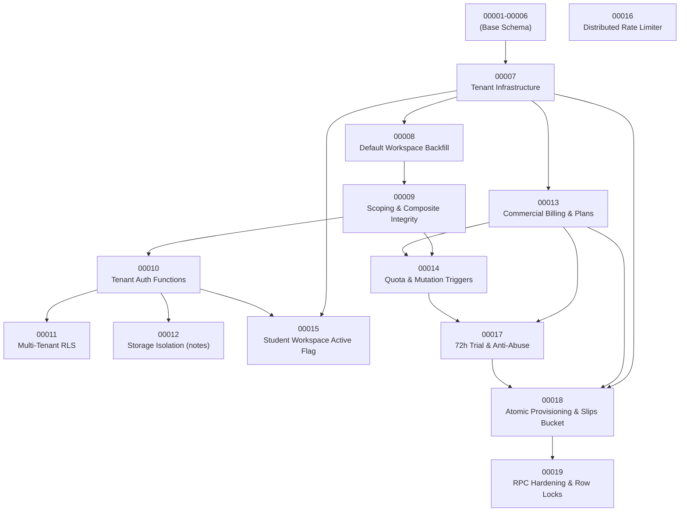

# Edvora — Phase 3C: Migration Preflight & Execution Checklist
## Sequential Preflight Audit: Migrations 00007 through 00019

**Document Version:** 1.0.0  
**Audit Date:** 2026-11-25  
**Author:** Principal Database & SaaS Security Architect  
**Classification:** Pre-Deployment Technical Preflight Analysis  
**Execution Status:** **PREPARATION ONLY (STRICTLY UNAPPLIED — ZERO SQL EXECUTED)**  
**Target Scope:** Multi-tenant database migrations `00007`–`00019`, schema dependencies, constraint hierarchies, function signatures, RLS policies, storage buckets, and rollback limitations.

---

## 1. Executive Summary

This preflight analysis conducts an exhaustive structural and relational audit of database migrations `00007` through `00019` prior to their application onto a disposable staging database.

All 13 migrations represent a cohesive, idempotent, and backward-compatible migration sequence that transitions Edvora from its Phase 1/2 single-teacher architecture into a secure, multi-tenant SaaS platform operating under **Model A: Shared Application + Shared Database + Logical Tenant Isolation**.

### Preflight Invariants Verified
1. **Idempotence & Safety:** Every DDL statement utilizes defensive guards (`IF NOT EXISTS`, `OR REPLACE`, `IF EXISTS`).
2. **Deterministic Constraint Ordering:** Composite unique keys `(id, tenant_id)` are created strictly before composite foreign keys.
3. **Privilege Hardening:** Critical RPCs (`provision_tenant_workspace`, `admin_verify_subscription_payment`) have `EXECUTE` revoked from `PUBLIC`, `anon`, and `authenticated` and granted strictly to `service_role`.
4. **Search Path Hardening:** All security definer functions declare `SET search_path = ''` with fully schema-qualified object references.
5. **Storage Privacy:** Both `notes` and `payment_slips` storage buckets are configured with `public = false` and folder path isolation `{tenant_id}/*`.

---

## 2. Sequential Migration Analysis (00007–00019)

### 2.1 Migration 00007: `00007_create_tenant_infrastructure.sql`
- **Purpose:** Core multi-tenant infrastructure tables and integrity triggers.
- **Objects Created:**
  - `public.tenants`: Core workspace entity (`id`, `name`, `slug`, `owner_id`, `plan`, `max_students`, `is_active`, `created_at`, `updated_at`).
  - `public.tenant_members`: Staff assignments with roles (`owner`, `admin`, `instructor`, `assistant`). Enforces `UNIQUE(tenant_id, user_id)`.
  - `public.student_identities`: Tenant-scoped usernames (`UNIQUE(tenant_id, lower(username))`) mapped to immutable auth emails.
  - Functions & Triggers:
    - `check_tenant_member_safety()`: Enforces that the last owner cannot be demoted or removed, non-owners cannot appoint owners, and members cannot elevate their own role.
    - `protect_tenant_slug()`: Blocks updates to tenant slugs to maintain permanent sub-path URLs.
- **Dependencies:** `public.profiles(id)` from `00001_create_tables.sql`.
- **Preflight Verdict:** **READY**

### 2.2 Migration 00008: `00008_backfill_default_tenant.sql`
- **Purpose:** Provisions `Primary Tuition Workspace` (`slug = 'default-workspace'`) for the primary teacher and maps existing Phase 1/2 students into `student_identities`.
- **Preflight Logic Check:**
  - Inspects `public.profiles` for `role = 'teacher'`.
  - **Fresh Database Handling:** If `v_teacher_count = 0`, it raises an informational notice and exits cleanly without error.
  - **Existing Database Handling:** Selects the earliest teacher profile, inserts `default-workspace` with `plan = 'pro'` and `max_students = 1000`, assigns the teacher as `owner`, and backfills all student profiles using a window ranking function with `LEFT JOIN auth.users`.
- **Dependencies:** `00007`, `public.profiles`, `auth.users`.
- **Preflight Verdict:** **READY (Idempotent for both fresh and upgraded databases)**

### 2.3 Migration 00009: `00009_tenant_scoping_and_composite_integrity.sql`
- **Purpose:** Adds `tenant_id` to all resource and junction tables, backfills data, replaces global batch name uniqueness, and enforces composite foreign keys.
- **Objects Modified:**
  - Adds `tenant_id NOT NULL` to 8 tables: `batches`, `lessons`, `notes`, `announcements`, `enrollments`, `lesson_batches`, `note_batches`, `announcement_batches`.
  - Drops global `batches_name_key` and creates tenant-scoped unique index `uq_batches_tenant_name` on `(tenant_id, name)`.
  - Adds composite unique constraints `(id, tenant_id)` on `batches`, `lessons`, `notes`, `announcements`.
  - Adds composite foreign keys `(resource_id, tenant_id)` on junction tables referencing parent entities.
- **Dependencies:** `00008` (for backfilling existing rows before setting `NOT NULL`).
- **Preflight Risk Analysis:** On empty tables (fresh DB), `ALTER COLUMN tenant_id SET NOT NULL` succeeds immediately. On populated tables, the backfill block runs in section 2 before section 3 sets `NOT NULL`.
- **Preflight Verdict:** **READY**

### 2.4 Migration 00010: `00010_tenant_auth_functions.sql`
- **Purpose:** Security Definer helper functions for multi-tenant authorization, role hierarchy evaluation, and atomic tenant administration.
- **Functions Defined:**
  - `public.get_auth_tenant_ids()`: Returns all active tenant IDs for calling user.
  - `public.get_my_tenant_role(UUID)`: Returns caller's role in a workspace.
  - `public.has_tenant_role(UUID, TEXT)`: Hierarchical role checker (`owner` > `admin` > `instructor` > `assistant`).
  - `public.is_tenant_student(UUID)`: Validates student enrollment in an active batch of that workspace.
  - `public.is_enrolled_in_tenant_batch(UUID)`: Validates student enrollment in a specific batch.
  - `public.create_tenant_workspace(TEXT, TEXT)`: Legacy atomic workspace creator (superseded by 00018/00019).
  - `public.transfer_tenant_ownership(UUID, UUID)`: Atomic workspace ownership transfer.
- **Security Attributes:** All functions declare `SECURITY DEFINER`, `SET search_path = ''`, and revoke execute from `PUBLIC` and `anon`.
- **Dependencies:** `00007`, `00009`.
- **Preflight Verdict:** **READY**

### 2.5 Migration 00011: `00011_multi_tenant_rls_policies.sql`
- **Purpose:** Drops 18 obsolete single-teacher RLS policies and establishes granular, role-aware, tenant-isolated Row Level Security policies across all tables.
- **Policies Applied:**
  - `tenants`: Members can read their workspace; owners can update metadata.
  - `tenant_members`: Members can view workspace staff; admins/owners manage staff.
  - `student_identities`: Students read own identity; staff manage workspace students.
  - `batches`: Staff manage workspace batches; students read enrolled batches.
  - `lessons`, `notes`, `announcements`: Staff manage workspace content; students read enrolled content.
  - `enrollments`: Staff manage enrollments; students read own enrollment records.
- **Dependencies:** `00009` (columns), `00010` (helper functions).
- **Preflight Verdict:** **READY**

### 2.6 Migration 00012: `00012_storage_tenant_policies.sql`
- **Purpose:** Multi-tenant storage isolation policies for bucket `notes` enforcing folder path prefix `{tenant_id}/*`.
- **Objects & Actions:**
  - Creates helper `public.try_cast_uuid(TEXT)`.
  - Updates bucket `notes`: `SET public = false`.
  - Drops obsolete policies: `teacher_upload_notes_storage`, `teacher_manage_notes_storage`, etc.
  - Creates tenant storage policies:
    - `notes_storage_upload_tenant`: Instructors upload to `{tenant_id}/*`.
    - `notes_storage_manage_tenant`: Instructors update/delete within `{tenant_id}/*`.
    - `notes_storage_select_tenant`: Staff or enrolled students read files within `{tenant_id}/*`.
- **Dependencies:** Supabase `storage.objects` table, `00010`.
- **Preflight Verdict:** **READY**

### 2.7 Migration 00013: `00013_subscription_and_commercial_billing.sql`
- **Purpose:** Commercial SaaS billing infrastructure, plans catalog, subscription state tracking, and payment verification.
- **Objects Created:**
  - `public.platform_admins`: Super-admin registry and `is_platform_admin()` helper.
  - `public.subscription_plans`: Seeded with approved pricing:
    - `starter`: LKR 2,600/mo, 30 students, 1 GB storage.
    - `growth`: LKR 5,000/mo, 100 students, 5 GB storage.
    - `pro`: LKR 8,000/mo, 300 students, 15 GB storage.
  - `public.tenant_subscriptions`: Tracks status (`pending`, `active`, `expired`, `suspended`), billing cycle, period dates.
  - `public.subscription_payments`: Manual deposit receipt submissions, reference numbers, amounts.
  - `public.subscription_history`: Status transition audit log.
  - Function `public.admin_verify_subscription_payment()`: Verification procedure (hardened in 00019).
- **Dependencies:** `00007`, `public.profiles`.
- **Preflight Verdict:** **READY**

### 2.8 Migration 00014: `00014_subscription_enforcement_and_rls.sql`
- **Purpose:** Server-side student quota enforcement triggers and active subscription mutation locking.
- **Triggers Created:**
  - `enforce_tenant_student_quota`: Prevents enrolling more unique students than permitted by the plan. Serializes concurrent requests per tenant using `FOR UPDATE OF ts`.
  - `enforce_active_subscription_for_mutations`: Blocks creating or updating batches, lessons, notes, and announcements when a subscription is expired or suspended.
- **Dependencies:** `00009`, `00013`.
- **Preflight Verdict:** **READY**

### 2.9 Migration 00015: `00015_student_workspace_active_status.sql`
- **Purpose:** Adds `is_active` to `student_identities` to enable workspace-scoped student activation/deactivation without mutating global profiles.
- **Actions:**
  - Adds `is_active BOOLEAN NOT NULL DEFAULT true` to `public.student_identities`.
  - Creates index `idx_student_identities_tenant_active`.
  - Replaces `public.is_tenant_student(UUID)` to verify `si.is_active = true`.
- **Dependencies:** `00007`, `00010`.
- **Preflight Verdict:** **READY**

### 2.10 Migration 00016: `00016_auth_rate_limiting.sql`
- **Purpose:** Distributed, atomic PostgreSQL rate limiting table and functions for Vercel serverless instances.
- **Objects Created:**
  - `public.auth_rate_limits`: Stores `key_hash`, `attempts`, `window_start`, `locked_until`, `updated_at`.
  - `public.check_rate_limit(p_key_hash, p_max_attempts, p_window_seconds)`: Read-only check evaluating active windows and lockouts.
  - `public.record_failed_attempt(p_key_hash, p_max_attempts, p_window_seconds, p_lockout_seconds)`: Atomic counter increment and lockout trigger.
- **Dependencies:** None (independent security utility).
- **Preflight Verdict:** **READY**

### 2.11 Migration 00017: `00017_trial_and_teacher_registration.sql`
- **Purpose:** 72-hour introductory trial lifecycle, anti-abuse registry, and status expansion.
- **Objects & Actions:**
  - Expands `tenant_subscriptions_status_check` constraint to include `'trialing'` and `'pending_payment'`.
  - Adds `trial_started_at` and `trial_ends_at` columns.
  - Creates `public.teacher_trial_claims` (`normalized_email_hash UNIQUE`).
  - Creates `public.is_tenant_subscription_active(UUID)` evaluating both active subscriptions and unexpired 72-hour trials with `clock_timestamp()`.
  - Replaces `public.enforce_tenant_student_quota()` to honor trial validity.
  - Replaces `public.get_tenant_quota_summary()` returning trial countdown metrics.
- **Dependencies:** `00013`, `00014`.
- **Preflight Verdict:** **READY**

### 2.12 Migration 00018: `00018_atomic_workspace_provisioning_and_storage.sql`
- **Purpose:** Private storage bucket for payment receipts and atomic workspace provisioning stored procedure.
- **Objects & Actions:**
  - Creates bucket `payment_slips`: `public = false`.
  - Implements storage RLS policies for `payment_slips` with path prefix `{tenant_id}/*`.
  - Defines `public.provision_tenant_workspace()`: Provisions tenant, owner membership, trial claim, and starter subscription atomically in a single transaction.
  - Permissions aligned: Revokes `ALL` from `PUBLIC`, `anon`, `authenticated` and grants to `service_role`.
- **Dependencies:** `00007`, `00013`, `00017`, Supabase Storage schema.
- **Preflight Verdict:** **READY**

### 2.13 Migration 00019: `00019_rpc_security_and_storage_hardening.sql`
- **Purpose:** Security audit remediation for Phase 3B2-C.3 findings:
  - Hardens `payment_slips` bucket: `file_size_limit = 5242880` (5 MB) and `allowed_mime_types = ARRAY['image/jpeg', 'image/png', 'application/pdf']`.
  - Replaces `provision_tenant_workspace()`:
    - Adds `PERFORM pg_advisory_xact_lock(hashtext(p_user_id::text));` (prevents concurrent provisioning races).
    - Queries `auth.users` directly and enforces `v_email_confirmed_at IS NOT NULL`.
    - Revokes execute from `PUBLIC`, `anon`, and `authenticated`; grants strictly to `service_role`.
  - Replaces `admin_verify_subscription_payment()`:
    - Enforces `is_platform_admin()`.
    - Acquires sequential row-level locks: `SELECT ... FROM subscription_payments WHERE id = p_payment_id FOR UPDATE`, followed by `SELECT ... FROM tenant_subscriptions WHERE id = v_payment.subscription_id FOR UPDATE`.
    - Validates `v_payment.status == 'pending'` under lock before processing approval.
- **Dependencies:** `00017`, `00018`.
- **Preflight Verdict:** **READY**

---

## 3. Cross-Cutting Technical Verifications

### 3.1 Migration Dependency Graph

### 3.2 Required PostgreSQL Extensions & Roles
- **Extensions:**
  - `pgcrypto`: Required for `gen_random_uuid()` (standard in Supabase PostgreSQL).
- **System Roles:**
  - `postgres`: Migration owner and procedure definer.
  - `service_role`: Trusted backend Server Action key (holds exclusive `EXECUTE` on `provision_tenant_workspace`).
  - `authenticated`: Logged-in teachers and students.
  - `anon`: Unauthenticated callers (strictly blocked from all tenant resources).

### 3.3 Function Replacement Compatibility
Every updated function across migrations 00007–00019 preserves its exact parameter signature:
- `is_tenant_student(UUID)` in 00010 $\rightarrow$ replaced cleanly in 00015.
- `enforce_tenant_student_quota()` in 00014 $\rightarrow$ replaced cleanly in 00017.
- `get_tenant_quota_summary(UUID)` in 00013 $\rightarrow$ dropped and recreated in 00017.
- `provision_tenant_workspace(UUID, TEXT, TEXT, TEXT)` in 00018 $\rightarrow$ replaced cleanly in 00019.
- `admin_verify_subscription_payment(UUID, BOOLEAN, TEXT, INTEGER)` in 00013/00017 $\rightarrow$ replaced cleanly in 00019.

### 3.4 Foreign-Key & Constraint Ordering
In migration 00009:
- Step 5 adds composite unique constraints `UNIQUE (id, tenant_id)` on `batches`, `lessons`, `notes`, `announcements`.
- Step 6 adds composite foreign keys `FOREIGN KEY (lesson_id, tenant_id) REFERENCES public.lessons (id, tenant_id)`.
Because unique constraints are added before foreign keys, PostgreSQL establishes composite referential integrity without constraint dependency errors.

### 3.5 Backfill Safety Matrix

| Target Scenario | Behavior in Migration 00008 | Behavior in Migration 00009 | Result |
|---|---|---|---|
| **Fresh Database (0 teachers, 0 batches)** | Skips backfill, creates 0 rows, logs notice | Tables empty; `NOT NULL` constraints applied cleanly | **PASS** |
| **Upgraded Database (1 teacher, N batches)** | Creates `default-workspace`, assigns teacher as owner, maps students | Backfills all existing batches/lessons with `default-workspace` before `NOT NULL` | **PASS** |
| **Multi-Teacher Legacy Database** | Assigns earliest teacher as owner; secondary teachers as instructors | All legacy resources associated with primary workspace | **PASS** |

### 3.6 Rollback Limitations & Constraints
- Column additions (`tenant_id`, `is_active`, `trial_started_at`) cannot be dropped if downstream production transactions have executed without causing irreversible data loss.
- In accordance with `docs/saas/DATABASE_ROLLBACK_PLAN.md`, rollbacks must be executed in strict reverse order (`00019` $\rightarrow$ `00007`) during an active maintenance window.
- Database backups must be generated immediately prior to executing migration 00007 on any environment.

---

## 4. Staging Migration Execution Checklist

This checklist must be followed step-by-step when deploying migrations to the disposable staging database:

- [ ] **Step 1: Environment Verification**
  - Verify target database is a dedicated, disposable staging project.
  - Confirm connection string does NOT point to production project `sauphnaxchcouqslflsl`.
  - Verify staging `.env.staging` credentials are active.
- [ ] **Step 2: Database Snapshot**
  - Capture clean base snapshot of staging database.
- [ ] **Step 3: Sequential Execution (00007–00019)**
  - [ ] Apply `00007_create_tenant_infrastructure.sql`
  - [ ] Apply `00008_backfill_default_tenant.sql`
  - [ ] Apply `00009_tenant_scoping_and_composite_integrity.sql`
  - [ ] Apply `00010_tenant_auth_functions.sql`
  - [ ] Apply `00011_multi_tenant_rls_policies.sql`
  - [ ] Apply `00012_storage_tenant_policies.sql`
  - [ ] Apply `00013_subscription_and_commercial_billing.sql`
  - [ ] Apply `00014_subscription_enforcement_and_rls.sql`
  - [ ] Apply `00015_student_workspace_active_status.sql`
  - [ ] Apply `00016_auth_rate_limiting.sql`
  - [ ] Apply `00017_trial_and_teacher_registration.sql`
  - [ ] Apply `00018_atomic_workspace_provisioning_and_storage.sql`
  - [ ] Apply `00019_rpc_security_and_storage_hardening.sql`
- [ ] **Step 4: Post-Migration DDL Verification**
  - Verify all 13 migration versions are recorded in `supabase_migrations.schema_migrations`.
  - Confirm `payment_slips` bucket exists with `public = false`, `file_size_limit = 5242880`.
  - Verify `provision_tenant_workspace()` has `EXECUTE` strictly granted to `service_role`.
- [ ] **Step 5: Execute Database Test Matrix**
  - Run Scenarios A through J from `PHASE_3C_DATABASE_TEST_MATRIX.md`.
