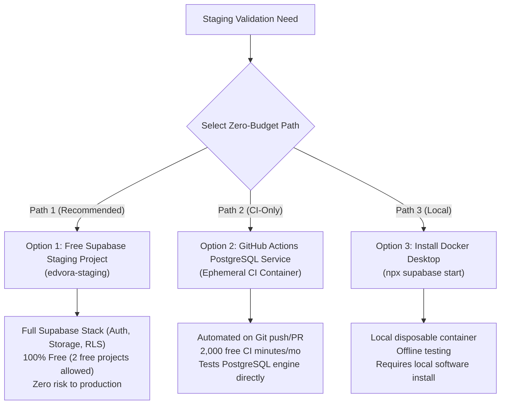

# Edvora — Phase 3C: Staging Validation Master Plan
## Environment Assessment, Zero-Budget Staging Architecture & Deployment Protocol

**Document Version:** 1.0.0  
**Date:** 2026-11-25  
**Author:** Principal Database & SaaS Security Architect  
**Classification:** Staging Strategy & Environment Specification  
**Status:** **PREPARATION ONLY (AWAITING USER SELECTION & APPROVAL — ZERO MIGRATIONS APPLIED)**  
**Strict Project Constraints:** Zero paid infrastructure, zero migrations against production project `sauphnaxchcouqslflsl`, zero production credential exposure.

---

## 1. Environment Assessment & Current State

A thorough, non-intrusive assessment of the current Edvora environment was conducted. The findings are documented below:

### 1.1 Configured Project Analysis
- **Active Environment File:** `.env.local`
- **Configured Project Ref:** `sauphnaxchcouqslflsl`
- **Project Classification:** **Active Development / Production Project** containing the baseline single-teacher application schema (`00001`–`00006`).
- **Staging Separation:** **NO** separate staging project is currently configured. There is no `.env.staging` or `.env.production` file in the repository.

### 1.2 Local Host Environment Capabilities
- **Docker Engine:** `docker` is **not installed** on this Windows host.
- **PostgreSQL Client:** `psql` is **not installed** on this Windows host.
- **Supabase CLI:** Installed and accessible via `npx supabase` (v3.4.0).
- **Implication:** The local workstation cannot run `supabase start` (which requires Docker) without the user installing Docker Desktop.

### 1.3 Critical Security Conclusion
> [!CAUTION]
> **Production Protection Invariant:** Migrations `00007` through `00019` **MUST NOT** be applied to project `sauphnaxchcouqslflsl`. Doing so would mutate the active development/production database without a disposable, isolated pre-validation run.
> 
> Because no separate staging database currently exists, all migration execution is **HALTED** in strict compliance with project rules:  
> *"If no separate staging database exists, stop and explain the safest available zero-budget options. Do not apply migrations."*

---

## 2. Safest Zero-Budget Staging Options

To enable real PostgreSQL validation without incurring costs or risking production data, three zero-budget paths are available:



---

### Option 1 (Recommended): Second Free Supabase Cloud Project (`edvora-staging`)

- **Cost:** **$0.00 / Free** (The Supabase Free Plan explicitly permits **2 free organizations/projects** per user account).
- **Architecture:** Complete staging replica including real Supabase Auth, real PostgREST APIs, real Supabase Storage (`payment_slips`, `notes`), and real PostgreSQL 15/16.
- **Isolation Level:** **100% physically isolated** from production project `sauphnaxchcouqslflsl`. It possesses distinct API keys, separate database passwords, and independent project URLs.
- **Workflow:**
  1. The user creates a new free project named `edvora-staging` in the Supabase Dashboard.
  2. The staging credentials are saved to `.env.staging` (or temporarily configured in `.env.local`).
  3. Migrations `00001` through `00019` are pushed to `edvora-staging`.
  4. The automated test harness and manual smoke tests are executed against `edvora-staging`.
  5. Once staging validation is approved, the project can be reset or retained as a permanent staging sandbox.
- **Feasibility:** **Immediate** (requires only creating a free project via the web dashboard).

---

### Option 2: Ephemeral PostgreSQL Service Container in GitHub Actions CI

- **Cost:** **$0.00 / Free** (GitHub Free includes **2,000 free CI minutes/month**).
- **Architecture:** A GitHub Actions workflow spins up an ephemeral `postgres:15` service container on each push or pull request.
- **Isolation Level:** **100% ephemeral**. The database is created in memory, migrations `00001`–`00019` are executed, the database test harness runs, and the container is permanently destroyed when the workflow finishes.
- **Limitations:** Validates PostgreSQL triggers, composite keys, RLS policies, and SQL functions, but does not provide live Supabase Auth email verification or Supabase Storage without mock layers.
- **Feasibility:** High for CI regression testing; best paired with Option 1 for end-to-end UI testing.

---

### Option 3: Local Docker Desktop Installation (`npx supabase start`)

- **Cost:** **$0.00 / Free** (Docker Desktop is free for personal/freelance use).
- **Architecture:** Spins up the full local Supabase container stack on the developer's PC via `npx supabase start`.
- **Isolation Level:** Local machine isolation.
- **Current Blocker:** Requires the user to download and install Docker Desktop for Windows.

---

## 3. Staging Setup & Deployment Protocol (Option 1 Execution Guide)

When Option 1 is selected, the deployment protocol proceeds as follows:

### Step 1: Create Staging Environment File (`.env.staging`)
Create `.env.staging` with isolated staging keys (never commit to git):
```env
# .env.staging — ISOLATED STAGING CREDENTIALS
NEXT_PUBLIC_SUPABASE_URL=https://<staging-project-ref>.supabase.co
NEXT_PUBLIC_SUPABASE_ANON_KEY=<staging-anon-key>
SUPABASE_SERVICE_ROLE_KEY=<staging-service-role-key>

# Staging Corporate Banking Configuration (SEC-3B2C2-LOW-02)
BANK_NAME=Commercial Bank of Ceylon (Staging)
BANK_BRANCH=Colombo Fort
BANK_ACCOUNT_NAME=Edvora Technologies Staging
BANK_ACCOUNT_NUMBER=1000998877
BANK_PAYMENT_INSTRUCTIONS=Staging test deposit: upload sample payment slip below.
```

### Step 2: Configure Staging SMTP (SEC-3B2C2-INFO-01)
In the Supabase Dashboard for the staging project:
- Navigate to **Authentication $\rightarrow$ SMTP Settings**.
- Enable Custom SMTP using a free provider (e.g. Resend free tier: 3,000 emails/month or Brevo: 300 emails/day).
- This ensures test teacher registrations receive verification emails without hitting Supabase Free's default rate limit (~3–4/hr).

### Step 3: Apply Migrations Sequentially
Link and apply migrations to the staging project:
```bash
# Link strictly to the staging project
npx supabase link --project-ref <staging-project-ref>

# Push all migrations 00001 through 00019 to staging
npx supabase db push
```

### Step 4: Execute Staging Test Suite
1. Run the transactional SQL simulation harness from `docs/saas/PHASE_3C_DATABASE_TEST_MATRIX.md`.
2. Execute the 9 Critical Security Scenarios (`SEC-TEST-01` through `SEC-TEST-09`).
3. Run the Next.js application pointed to `.env.staging` (`npm run dev`) and execute the live teacher onboarding smoke test:
   - Register new teacher account.
   - Verify email via link.
   - Initial sign-in $\rightarrow$ confirm atomic workspace provisioning.
   - Verify 72-hour trial banner countdown.
   - Submit sample payment receipt (PDF/PNG/JPEG).
   - Verify platform admin payment approval $\rightarrow$ confirm 30-day active subscription.

---

## 4. Current State & Approval Stop Gate

In strict observance of Phase 3C instructions:
- **Zero source files were modified.**
- **Zero migrations were executed against production project `sauphnaxchcouqslflsl`.**
- **Zero commits were pushed.**
- **Preparation is 100% complete.**

We now await the user's direction on which zero-budget staging option to utilize.
