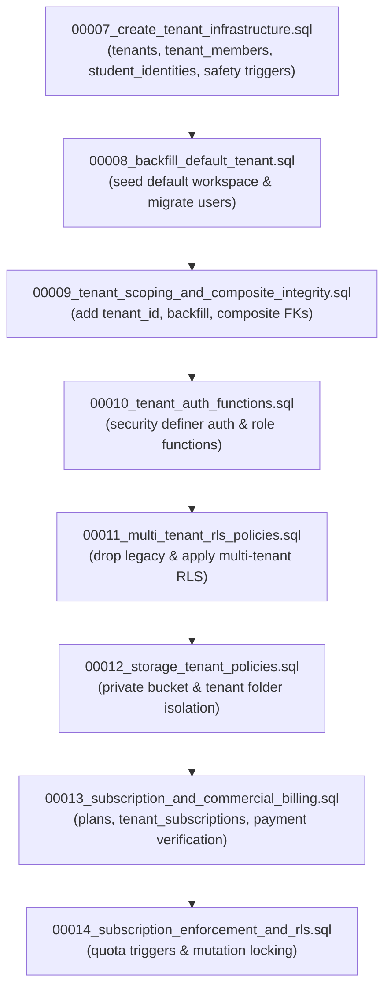

# Edvora Multi-Tenant SaaS — Database Migration Plan

> [!IMPORTANT]
> **Status**: PREPARATION-ONLY ARCHITECTURAL SPECIFICATION.  
> All migration scripts and plans have been statically audited and staged inside the repository.  
> **DO NOT** execute these scripts against production or staging databases until scheduled maintenance window approval.

---

## 1. Executive Summary & Architecture Model

Edvora is transitioning from a single-teacher learning portal into a production-grade multi-tenant SaaS platform under **Model A: Shared Application + Shared Database + Tenant Isolation**.

### Architecture Tenets
1. **Strict Logical Isolation**: Every tenant (tuition teacher workspace) operates within an isolated boundary.
2. **Commercial Paid-Only Architecture**: No permanent free tier. Workspaces operate under configurable subscription plans (`starter`, `growth`, `pro`) with manual payment verification and future online gateways.
3. **Engine-Level Defense-in-Depth**:
   - **Database Integrity**: Composite unique keys and composite foreign keys `(resource_id, tenant_id)` physically prevent cross-tenant associations.
   - **Row Level Security (RLS)**: Security definer functions with empty `search_path` evaluate tenant boundaries without risk of recursion.
   - **Private Storage**: Bucket `'notes'` is strictly private (`public = false`) to prevent CDN-level bypassing of tenant boundaries.
4. **Preserved Backwards Compatibility**: The existing production teacher and student dataset is backfilled into `default-workspace` with zero data loss or disrupted student logins.

---

## 2. Migration Staging & Sequential Execution Roadmap

The migration sequence consists of eight unapplied, idempotent SQL scripts numbered `00007` through `00014`:

```
supabase/migrations/
├── 00007_create_tenant_infrastructure.sql
├── 00008_backfill_default_tenant.sql
├── 00009_tenant_scoping_and_composite_integrity.sql
├── 00010_tenant_auth_functions.sql
├── 00011_multi_tenant_rls_policies.sql
├── 00012_storage_tenant_policies.sql
├── 00013_subscription_and_commercial_billing.sql
└── 00014_subscription_enforcement_and_rls.sql
```



---

## 3. Detailed Migration Breakdown

### Phase 1: Core Tenant Infrastructure (`00007`)
- **File**: [00007_create_tenant_infrastructure.sql](file:///c:/Users/E-TEC/Desktop/FREELANCING%20PROJECTS/EDVORA%20-%20Learning%20Management%20System/edvora/supabase/migrations/00007_create_tenant_infrastructure.sql)
- **Objects**:
  - `public.tenants`: Workspace metadata, immutable slugs (`trg_protect_tenant_slug`), owner profile reference.
  - `public.tenant_members`: Staff assignments with roles (`owner`, `admin`, `instructor`, `assistant`). UUID primary key + `UNIQUE(tenant_id, user_id)`.
  - `public.student_identities`: Tenant-scoped student usernames (`uq_idx_student_identities_lower_username`) mapped to immutable auth emails.
  - Triggers: Last owner safety, self-demotion prevention, non-owner elevation prevention (`check_tenant_member_safety`), and slug immutability.

### Phase 2: Default Tenant Backfill (`00008`)
- **File**: [00008_backfill_default_tenant.sql](file:///c:/Users/E-TEC/Desktop/FREELANCING%20PROJECTS/EDVORA%20-%20Learning%20Management%20System/edvora/supabase/migrations/00008_backfill_default_tenant.sql)
- **Actions**: Provisions `Primary Tuition Workspace` (`slug = 'default-workspace'`) for the primary teacher, associates secondary teachers as instructors, and backfills all student profiles into `student_identities` via a collision-free window ranking function with `LEFT JOIN auth.users`, preserving existing `@edvora.internal` auth emails.

### Phase 3: Tenant Scoping & Composite Integrity (`00009`)
- **File**: [00009_tenant_scoping_and_composite_integrity.sql](file:///c:/Users/E-TEC/Desktop/FREELANCING%20PROJECTS/EDVORA%20-%20Learning%20Management%20System/edvora/supabase/migrations/00009_tenant_scoping_and_composite_integrity.sql)
- **Actions**: Adds `tenant_id NOT NULL` to 8 tables (`batches`, `lessons`, `notes`, `announcements`, `enrollments`, `lesson_batches`, `note_batches`, `announcement_batches`). Enforces tenant-scoped unique batch names and composite foreign keys `(id, tenant_id)`.

### Phase 4: Tenant Auth Helper Functions (`00010`)
- **File**: [00010_tenant_auth_functions.sql](file:///c:/Users/E-TEC/Desktop/FREELANCING%20PROJECTS/EDVORA%20-%20Learning%20Management%20System/edvora/supabase/migrations/00010_tenant_auth_functions.sql)
- **Functions**: `get_auth_tenant_ids()`, `has_tenant_role()`, `is_tenant_student()`, `is_enrolled_in_tenant_batch()`, atomic workspace creation, and atomic ownership transfer. All defined as `SECURITY DEFINER` with `SET search_path = ''`.

### Phase 5: Multi-Tenant RLS Policies (`00011`)
- **File**: [00011_multi_tenant_rls_policies.sql](file:///c:/Users/E-TEC/Desktop/FREELANCING%20PROJECTS/EDVORA%20-%20Learning%20Management%20System/edvora/supabase/migrations/00011_multi_tenant_rls_policies.sql)
- **Actions**: Drops 18 obsolete single-teacher policies. Establishes granular CRUD policies across all tables. Restricts member role assignments so admins cannot create owners or modify their own roles.

### Phase 6: Storage Tenant Isolation & Privacy (`00012`)
- **File**: [00012_storage_tenant_policies.sql](file:///c:/Users/E-TEC/Desktop/FREELANCING%20PROJECTS/EDVORA%20-%20Learning%20Management%20System/edvora/supabase/migrations/00012_storage_tenant_policies.sql)
- **Actions**: Sets bucket `notes` to private (`public = false`). Enforces folder path isolation `{tenant_id}/*` for uploads, updates, and deletes. Preserves read access for legacy un-prefixed files.

### Phase 7: Commercial Subscription Architecture (`00013`)
- **File**: [00013_subscription_and_commercial_billing.sql](file:///c:/Users/E-TEC/Desktop/FREELANCING%20PROJECTS/EDVORA%20-%20Learning%20Management%20System/edvora/supabase/migrations/00013_subscription_and_commercial_billing.sql)
- **Objects**:
  - `public.platform_admins`: Super-administrator registry and `is_platform_admin()` helper.
  - `public.subscription_plans`: Configurable tiers seeded with approved monthly rates (Starter @ LKR 2,600/mo, Growth @ LKR 5,000/mo, Pro @ LKR 8,000/mo). Annual pricing is nullable (unfinalized); quotas are provisional placeholders. Non-destructive seeding with `ON CONFLICT (code) DO NOTHING`.
  - `public.tenant_subscriptions`: Tracks lifecycle states (`pending`, `active`, `expired`, `suspended`).
  - `public.subscription_payments`: Tracks deposit slip submissions, reference numbers, and verification logs.
  - `public.subscription_history`: Status transition audit trail.
  - Function `admin_verify_subscription_payment()`: Atomic verification and period extension.

### Phase 8: Subscription Enforcement Triggers & RLS (`00014`)
- **File**: [00014_subscription_enforcement_and_rls.sql](file:///c:/Users/E-TEC/Desktop/FREELANCING%20PROJECTS/EDVORA%20-%20Learning%20Management%20System/edvora/supabase/migrations/00014_subscription_enforcement_and_rls.sql)
- **Actions**:
  - Trigger `enforce_tenant_student_quota`: Prevents enrolling more unique students than permitted by the plan. Serializes concurrent enrollment requests per-tenant using row-level exclusive locking (`FOR UPDATE OF ts`) to eliminate TOCTOU race conditions.
  - Trigger `enforce_active_subscription_for_mutations`: Blocks creating or updating batches, lessons, notes, and announcements when subscription is expired or suspended.
- **Actions**:
  - Trigger `enforce_tenant_student_quota`: Prevents enrolling more unique students than permitted by the plan.
  - Trigger `enforce_active_subscription_for_mutations`: Blocks creating or updating batches, lessons, notes, and announcements when subscription is expired or suspended.

---

## 4. Execution Prerequisites & Guidelines

1. **Database Backup**: Take a point-in-time recovery snapshot (PITR) via Supabase dashboard before executing.
2. **Transaction Scoping**: Scripts `00007` through `00014` must each execute in dedicated transaction blocks (`BEGIN; ... COMMIT;`).
3. **Execution Order**: Strictly ascending: `00007` $\to$ `00008` $\to$ `00009` $\to$ `00010` $\to$ `00011` $\to$ `00012` $\to$ `00013` $\to$ `00014`.
