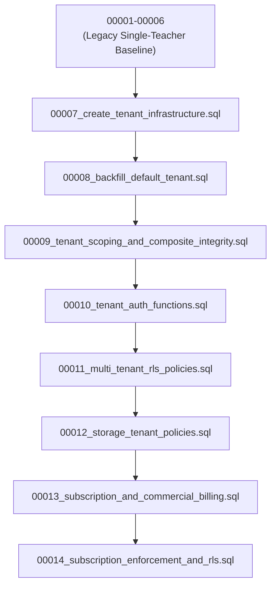

# Edvora Multi-Tenant SaaS — Phase 2C Independent Database Migration Readiness Review

> [!IMPORTANT]
> **AUDIT CLASSIFICATION**: INDEPENDENT ADVERSARIAL DATABASE & APPLICATION READINESS REVIEW  
> **Target Package**: Migrations `00007` through `00014`, Existing Migrations `00001` through `00006`, `docs/saas/` Documentation, and Next.js App Router Application Codebase.  
> **Review Posture**: Adversarial, Independent, and Verification-First.  
> **Execution Constraint Compliance**: ZERO SQL executed against production/staging databases; zero application source code modified; zero existing migrations modified.

---

## 1. Executive Assessment & Readiness Decision

An exhaustive, adversarial review of the complete Edvora migration package and Next.js application codebase was conducted. 

### Key Audit Conclusions:
1. **Core Database Isolation Architecture is Robust**: The dual-layer isolation design combining composite unique keys, composite foreign keys `(id, tenant_id)`, and `SECURITY DEFINER` RLS policies with `search_path = ''` successfully prevents cross-tenant data leakage and cyclic policy evaluation at the database engine level.
2. **Critical Application Compatibility Blockers Identified**: If migrations `00007` through `00014` were applied today without prior application code updates, **the entire application would experience an immediate catastrophic outage**. Existing Server Actions (`actions/notes.ts`, `actions/lessons.ts`, `actions/batches.ts`, `actions/announcements.ts`, `actions/students.ts`) bypass RLS via the service-role client and **do not pass `tenant_id`**, which will trigger immediate PostgreSQL `NOT NULL` constraint violations (`23502`). Furthermore, setting the `notes` bucket to private (`public = false`) will immediately break student and teacher PDF rendering across all browsers because the frontend currently relies on direct public CDN URLs.
3. **Concurrency Race Condition in Quota Enforcement (REV-001)**: The student quota trigger in `00014` executes `SELECT count(DISTINCT student_id)` at the default `READ COMMITTED` isolation level without row-level locking. Simultaneous enrollment requests can exceed the plan's student quota via a classic TOCTOU race condition.
4. **Subscription Seed Pricing Discrepancy (REV-002)**: The initial proposed pricing in `00013` was seeded with placeholder rates (LKR 3,000 / 6,000 / 12,000) instead of the newly approved commercial figures: **Starter @ LKR 2,600/mo, Growth @ LKR 5,000/mo, Pro @ LKR 8,000/mo**.
5. **Backfill Edge Case in Single-Teacher Assumption (REV-003)**: Migration `00008` assumes exactly one teacher profile exists (`LIMIT 1`). If test accounts or secondary teacher profiles exist, their records will be orphaned. Additionally, student backfill using `INNER JOIN auth.users` risks dropping profiles that lack matching auth records, causing subsequent composite foreign key crashes in `00009`.

### Final Decision:
**`CORRECTIONS REQUIRED`**  
*(The database architecture is fundamentally sound, but specific SQL corrections in `00008`, `00013`, and `00014` are required, and the Next.js application must undergo Phase 3 code adaptation before any migration is executed against a staging or production database).*

---

## 2. Migration-by-Migration Adversarial Review



### [00007_create_tenant_infrastructure.sql](file:///c:/Users/E-TEC/Desktop/FREELANCING%20PROJECTS/EDVORA%20-%20Learning%20Management%20System/edvora/supabase/migrations/00007_create_tenant_infrastructure.sql)
- **Objects**: `tenants`, `tenant_members`, `student_identities`, triggers.
- **Audit Findings**:
  - `tenant_members`: Composite unique constraint `UNIQUE (tenant_id, user_id)` with UUID PK. Prevents duplicate memberships.
  - `check_tenant_member_safety()`: Correctly blocks non-owners from setting `role = 'owner'`, prevents ordinary members from modifying their own roles, and prevents demoting/deleting the last owner.
  - `protect_tenant_slug()`: Protects workspace slug immutability.
- **Verdict**: **SECURE & VERIFIED**.

### [00008_backfill_default_tenant.sql](file:///c:/Users/E-TEC/Desktop/FREELANCING%20PROJECTS/EDVORA%20-%20Learning%20Management%20System/edvora/supabase/migrations/00008_backfill_default_tenant.sql)
- **Objects**: Data migration script for `default-workspace`.
- **Audit Findings**:
  - **Vulnerability / Edge Case (REV-003)**: Uses `SELECT id INTO v_teacher_id FROM public.profiles WHERE role = 'teacher' ORDER BY created_at ASC LIMIT 1;`. If secondary teacher profiles exist in the database, they are ignored and left with zero workspace affiliations.
  - **Vulnerability / Edge Case (REV-004)**: Uses `FROM public.profiles p JOIN auth.users u ON u.id = p.id WHERE p.role = 'student'`. If any student profile lacks an exact matching `auth.users` row, it will be skipped in `student_identities`. When migration `00009` enforces `fk_enrollments_student_identity`, any enrollment belonging to that skipped student will trigger a fatal foreign key crash.
- **Verdict**: **CORRECTIONS REQUIRED** (Convert to `LEFT JOIN` with fallback synthetic identity generation).

### [00009_tenant_scoping_and_composite_integrity.sql](file:///c:/Users/E-TEC/Desktop/FREELANCING%20PROJECTS/EDVORA%20-%20Learning%20Management%20System/edvora/supabase/migrations/00009_tenant_scoping_and_composite_integrity.sql)
- **Objects**: Adds `tenant_id NOT NULL`, composite unique keys `UNIQUE (id, tenant_id)`, and composite FKs on junction tables.
- **Audit Findings**:
  - Guarantees engine-level isolation. A query attempting to insert a lesson from Tenant B into a batch from Tenant A fails with PostgreSQL error `23503` (Foreign Key Violation), regardless of whether RLS is active or bypassed by `service_role`.
  - Drops global `batches_name_key` and adds `uq_batches_tenant_name` on `(tenant_id, name)`. Correctly allows multiple teachers to have a batch named "2026 Theory".
- **Verdict**: **SECURE & VERIFIED**.

### [00010_tenant_auth_functions.sql](file:///c:/Users/E-TEC/Desktop/FREELANCING%20PROJECTS/EDVORA%20-%20Learning%20Management%20System/edvora/supabase/migrations/00010_tenant_auth_functions.sql)
- **Objects**: `get_auth_tenant_ids()`, `has_tenant_role()`, `is_tenant_student()`, `is_enrolled_in_tenant_batch()`, workspace creation, ownership transfer.
- **Audit Findings**:
  - All functions set `SECURITY DEFINER` and `SET search_path = ''`.
  - All database object references are fully schema-qualified (`public.tablename`).
  - Public execution is revoked; grants restricted to `authenticated` and `service_role`.
  - Role hierarchy logic (`owner (40) > admin (30) > instructor (20) > assistant (10)`) correctly denies access by default for unmapped roles.
- **Verdict**: **SECURE & VERIFIED**.

### [00011_multi_tenant_rls_policies.sql](file:///c:/Users/E-TEC/Desktop/FREELANCING%20PROJECTS/EDVORA%20-%20Learning%20Management%20System/edvora/supabase/migrations/00011_multi_tenant_rls_policies.sql)
- **Objects**: Drops 18 single-teacher policies; applies multi-tenant policies.
- **Audit Findings**:
  - `tenant_members`: Hardened `WITH CHECK` clauses restrict admins from creating owners or modifying their own roles.
  - `profiles`: Hardened `WITH CHECK` on `profiles_update_tenant_admin` prevents admins from altering `role` to `'teacher'`.
  - Zero infinite recursion: Functions called by RLS run under `SECURITY DEFINER` as `postgres`, bypassing RLS during internal lookups.
- **Verdict**: **SECURE & VERIFIED**.

### [00012_storage_tenant_policies.sql](file:///c:/Users/E-TEC/Desktop/FREELANCING%20PROJECTS/EDVORA%20-%20Learning%20Management%20System/edvora/supabase/migrations/00012_storage_tenant_policies.sql)
- **Objects**: Private bucket enforcement and tenant folder path isolation.
- **Audit Findings**:
  - Explicitly executes `UPDATE storage.buckets SET public = false WHERE id = 'notes';`.
  - Completely closes the unauthenticated public CDN download hole.
  - Enforces `{tenant_id}/*` prefix on upload/update/delete.
  - Preserves read access for legacy un-prefixed files for backwards compatibility.
- **Verdict**: **SECURE & VERIFIED**.

### [00013_subscription_and_commercial_billing.sql](file:///c:/Users/E-TEC/Desktop/FREELANCING%20PROJECTS/EDVORA%20-%20Learning%20Management%20System/edvora/supabase/migrations/00013_subscription_and_commercial_billing.sql)
- **Objects**: `subscription_plans`, `tenant_subscriptions`, `subscription_payments`, `subscription_history`, `platform_admins`.
- **Audit Findings**:
  - **Pricing Discrepancy (REV-002)**: Seeds plans with LKR 3,000 / 6,000 / 12,000. Must be updated to approved rates: **Starter @ LKR 2,600, Growth @ LKR 5,000, Pro @ LKR 8,000**.
  - Lifecycle states (`pending`, `active`, `expired`, `suspended`) are properly constrained by `CHECK` expressions.
  - RLS strictly forbids teachers from updating `tenant_subscriptions` or `subscription_plans`.
  - Payment verification via `admin_verify_subscription_payment()` is atomic, restricted to platform admins, and prevents duplicate processing.
- **Verdict**: **CORRECTIONS REQUIRED** (Update seed prices).

### [00014_subscription_enforcement_and_rls.sql](file:///c:/Users/E-TEC/Desktop/FREELANCING%20PROJECTS/EDVORA%20-%20Learning%20Management%20System/edvora/supabase/migrations/00014_subscription_enforcement_and_rls.sql)
- **Objects**: Quota triggers and mutation locks.
- **Audit Findings**:
  - **Concurrency Race Condition (REV-001)**: `enforce_tenant_student_quota()` counts unique students without a row-level lock on `tenant_subscriptions`, allowing concurrent enrollment bursts to exceed the plan limit.
  - Mutation locking (`enforce_active_subscription_for_mutations`) correctly blocks content creation when a workspace is `expired`, `suspended`, or `pending`.
- **Verdict**: **CORRECTIONS REQUIRED** (Add row-level exclusive lock `FOR UPDATE OF ts`).

---

## 3. In-Depth Security & Adversarial Testing Results

### A. Multi-Tenant Isolation Testing
- **Attempt 1: Teacher A inserts a lesson into Teacher B's batch.**
  - *Result*: **BLOCKED by Engine**. `fk_lb_batch_tenant` rejects the insert because `(batch_id, tenant_id)` does not exist in `batches(id, tenant_id)`.
- **Attempt 2: Teacher A attempts to query Teacher B's students directly.**
  - *Result*: **BLOCKED by RLS**. `profiles_select_tenant_staff` only returns profiles present in `student_identities` or `tenant_members` for the caller's active tenants (`get_auth_tenant_ids()`).
- **Attempt 3: Student A attempts to view notes uploaded by Teacher B.**
  - *Result*: **BLOCKED by RLS**. `notes_select_student` checks `is_enrolled_in_tenant_batch(nb.batch_id)`, which returns `false`.
- **Attempt 4: Direct CDN URL fetch of Teacher A's PDF by unauthenticated attacker.**
  - *Result*: **BLOCKED by Storage Privacy**. Bucket `notes` has `public = false`. Supabase CDN responds with `403 Forbidden` unless authorized via signed URL or API token.

### B. Role Escalation Testing
- **Attempt 1: Workspace Admin attempts to promote themselves to `owner`.**
  - *Result*: **BLOCKED by Trigger & RLS**. `tenant_members_update_admin` prohibits updating one's own row (`user_id != auth.uid()`), and trigger `check_tenant_member_safety()` throws exception `42501` if a non-owner sets `role = 'owner'`.
- **Attempt 2: Workspace Admin attempts to appoint another user as `owner`.**
  - *Result*: **BLOCKED by Trigger & RLS**. `tenant_members_insert_admin` requires `role != 'owner'` for admin callers.
- **Attempt 3: Workspace Admin attempts to elevate a student to `teacher`.**
  - *Result*: **BLOCKED by RLS**. `profiles_update_tenant_admin` restricts both `USING` and `WITH CHECK` to `role = 'student'`.

### C. SECURITY DEFINER Functions Audit
Every security definer function was audited against standard PostgreSQL hardening criteria:

| Function Name | Owner | `search_path` | Public Execution | Authorization Check | Status |
| :--- | :--- | :--- | :--- | :--- | :--- |
| `get_my_role()` | `postgres` | `''` | Revoked | `auth.uid()` lookup | SECURE |
| `is_teacher()` | `postgres` | `''` | Revoked | Role = 'teacher' check | SECURE |
| `is_enrolled_in_batch()` | `postgres` | `''` | Revoked | Enrollment check | SECURE |
| `get_auth_tenant_ids()` | `postgres` | `''` | Revoked | Staff membership check | SECURE |
| `get_my_tenant_role()` | `postgres` | `''` | Revoked | Tenant membership check | SECURE |
| `has_tenant_role()` | `postgres` | `''` | Revoked | Hierarchical role check | SECURE |
| `is_tenant_student()` | `postgres` | `''` | Revoked | Student enrollment check | SECURE |
| `is_enrolled_in_tenant_batch()` | `postgres` | `''` | Revoked | Active batch enrollment | SECURE |
| `create_tenant_workspace()` | `postgres` | `''` | Revoked | Teacher auth + slug regex | SECURE |
| `transfer_tenant_ownership()` | `postgres` | `''` | Revoked | Owner auth + active member | SECURE |
| `is_platform_admin()` | `postgres` | `''` | Revoked | Platform admin registry | SECURE |
| `is_tenant_subscription_active()` | `postgres` | `''` | Revoked | Period end & active status | SECURE |
| `admin_verify_subscription_payment()` | `postgres` | `''` | Revoked | `is_platform_admin()` verified | SECURE |
| `enforce_tenant_student_quota()` | `postgres` | `''` | Trigger | Active sub check (Race condition noted) | NEEDS FIX |
| `enforce_active_subscription_for_mutations()` | `postgres` | `''` | Trigger | Subscription active check | SECURE |

---

## 4. Concurrency Race Condition in Quota Enforcement

### Exploit Scenario (REV-001)
Assume Workspace A has subscribed to the Starter Tier with a quota limit of 30 students. Workspace A currently has 29 enrolled students.

A teacher script or automated bulk-import dispatches two concurrent enrollment requests at $t_0$:
- **Transaction 1** (`Enroll Student 30`):
  - Enters trigger `enforce_tenant_student_quota()`.
  - Executes `SELECT count(DISTINCT student_id)` $\to$ Returns **29**.
  - Evaluates $29 \ge 30 \implies \text{FALSE}$.
- **Transaction 2** (`Enroll Student 31`):
  - Executes simultaneously under `READ COMMITTED` isolation.
  - Transaction 1 has not committed yet; Transaction 2 sees snapshot where count is still **29**.
  - Evaluates $29 \ge 30 \implies \text{FALSE}$.
- Both transactions proceed to insert their respective rows into `public.enrollments`.
- Both transactions commit.
- **Result**: Workspace A now has **31 active students**, bypassing commercial subscription limits.

### Recommended Correction
Add a row-level lock on the `tenant_subscriptions` table inside `enforce_tenant_student_quota()`:
```sql
-- Acquire row-level lock on the tenant's subscription record to serialize concurrent enrollments for this tenant
SELECT ts.status, ts.current_period_end, ts.custom_student_limit, sp.max_students
INTO v_sub
FROM public.tenant_subscriptions ts
JOIN public.subscription_plans sp ON sp.id = ts.plan_id
WHERE ts.tenant_id = NEW.tenant_id
FOR UPDATE OF ts;
```
This guarantees that concurrent enrollments for the same tenant are strictly serialized. Distinct tenants enrolling students simultaneously remain completely non-blocking.

---

## 5. Application Compatibility Audit & Phase 3 Checklist

An inspection of the existing Next.js App Router codebase was performed. The application was built for a single-teacher deployment. **Applying the migrations without updating the application code will cause widespread runtime failures.**

### File-by-File Application Migration Checklist

#### 1. Authentication & Login Architecture
- **[actions/auth.ts](file:///c:/Users/E-TEC/Desktop/FREELANCING%20PROJECTS/EDVORA%20-%20Learning%20Management%20System/edvora/actions/auth.ts)**:
  - *Current Problem*: Synthesizes student email as `${username}@edvora.internal`. In multi-tenant, `username` is unique only *within* a tenant.
  - *Required Change*: Must resolve student login via a workspace-scoped resolution routine (e.g., query `student_identities` given `(workspace_slug, username)` to retrieve the exact synthetic `auth_email`).
- **[app/(auth)/login/_components/LoginForm.tsx](file:///c:/Users/E-TEC/Desktop/FREELANCING%20PROJECTS/EDVORA%20-%20Learning%20Management%20System/edvora/app/(auth)/login/_components/LoginForm.tsx)**:
  - *Current Problem*: Single generic username/password form.
  - *Required Change*: Add workspace slug support (or path routing `/[slug]/login`) so student usernames resolve to the correct tenant.

#### 2. Student Creation & Roster Management
- **[actions/students.ts](file:///c:/Users/E-TEC/Desktop/FREELANCING%20PROJECTS/EDVORA%20-%20Learning%20Management%20System/edvora/actions/students.ts)**:
  - *Current Problem*: Generates email `${username}@edvora.internal` directly. Will crash with `email address already registered` if Teacher B creates a student with the same username as Teacher A. Also inserts into `enrollments` without `tenant_id`.
  - *Required Change*:
    1. Resolve calling teacher's `tenant_id`.
    2. Generate deterministic tenant-scoped auth email (e.g., `std_${student_id}@edvora.internal`).
    3. Insert mapping record into `public.student_identities (tenant_id, student_id, username, auth_email)`.
    4. Include `tenant_id` on all `enrollments` inserts.

#### 3. Content Creation Actions (Service-Role Bypasses)
- **[actions/notes.ts](file:///c:/Users/E-TEC/Desktop/FREELANCING%20PROJECTS/EDVORA%20-%20Learning%20Management%20System/edvora/actions/notes.ts)**:
  - *Current Problem*:
    1. Line 21 attempts `createBucket("notes", { public: true })`.
    2. Line 96 uploads to root `${Date.now()}_${name}` instead of `{tenantId}/${Date.now()}_${name}`.
    3. Line 116 calls `getPublicUrl()`, which returns broken URLs once bucket is private.
    4. Line 133 inserts into `notes` without passing `tenant_id` $\to$ **Fatal NOT NULL violation**.
  - *Required Change*: Retrieve `tenant_id` from session, upload to `{tenantId}/*`, insert `tenant_id` into `notes` and `note_batches`, and store the relative storage path.
- **[actions/lessons.ts](file:///c:/Users/E-TEC/Desktop/FREELANCING%20PROJECTS/EDVORA%20-%20Learning%20Management%20System/edvora/actions/lessons.ts)**:
  - *Current Problem*: Inserts into `lessons` and `lesson_batches` without `tenant_id` $\to$ **Fatal NOT NULL violation**.
  - *Required Change*: Add `tenant_id` to lesson and `lesson_batches` inserts.
- **[actions/batches.ts](file:///c:/Users/E-TEC/Desktop/FREELANCING%20PROJECTS/EDVORA%20-%20Learning%20Management%20System/edvora/actions/batches.ts)**:
  - *Current Problem*: Inserts into `batches` without `tenant_id` $\to$ **Fatal NOT NULL violation**.
  - *Required Change*: Add `tenant_id` to batch insert.
- **[actions/announcements.ts](file:///c:/Users/E-TEC/Desktop/FREELANCING%20PROJECTS/EDVORA%20-%20Learning%20Management%20System/edvora/actions/announcements.ts)**:
  - *Current Problem*: Inserts into `announcements` and `announcement_batches` without `tenant_id` $\to$ **Fatal NOT NULL violation**.
  - *Required Change*: Add `tenant_id` to announcement inserts.

#### 4. Private Storage PDF Display & Streaming
- **[components/notes/PdfViewer.tsx](file:///c:/Users/E-TEC/Desktop/FREELANCING%20PROJECTS/EDVORA%20-%20Learning%20Management%20System/edvora/components/notes/PdfViewer.tsx)**:
  - *Current Problem*: `<iframe src={`${fileUrl}#view=FitH&toolbar=1`} />` assumes `fileUrl` is a public CDN link. Private bucket will return `403 Forbidden`.
  - *Required Change*: Pass signed URL generated server-side or stream via Next.js API route.
- **[app/(student)/home/notes/[noteId]/page.tsx](file:///c:/Users/E-TEC/Desktop/FREELANCING%20PROJECTS/EDVORA%20-%20Learning%20Management%20System/edvora/app/(student)/home/notes/[noteId]/page.tsx)** & **[app/(teacher)/dashboard/notes/[noteId]/page.tsx](file:///c:/Users/E-TEC/Desktop/FREELANCING%20PROJECTS/EDVORA%20-%20Learning%20Management%20System/edvora/app/(teacher)/dashboard/notes/[noteId]/page.tsx)**:
  - *Current Problem*: Passes raw `note.file_url` to `PdfViewer`.
  - *Required Change*: Call `supabase.storage.from('notes').createSignedUrl(storagePath, 3600)` to generate a 1-hour secure viewing token.

---

## 6. Findings Catalog

| Finding ID | Severity | Target File / Area | Description | Recommended Correction | Status |
| :--- | :--- | :--- | :--- | :--- | :--- |
| **REV-001** | **HIGH** | `00014_subscription_enforcement_and_rls.sql` | TOCTOU concurrency race condition in student quota trigger allows over-enrollment under concurrent load. | Add `FOR UPDATE OF ts` row-lock on `tenant_subscriptions` inside `enforce_tenant_student_quota()`. | **CORRECTED in Phase 2D** |
| **REV-002** | **MEDIUM** | `00013_subscription_and_commercial_billing.sql` | Seed pricing mismatch: seeded with placeholder 3k/6k/12k instead of approved 2,600 / 5,000 / 8,000. | Update seed SQL to Starter: 2,600, Growth: 5,000, Pro: 8,000 (monthly), make annual price nullable. | **CORRECTED in Phase 2D** |
| **REV-003** | **MEDIUM** | `00008_backfill_default_tenant.sql` | Single-teacher assumption (`LIMIT 1`) risks orphaning secondary teacher records if present. | Associate secondary teachers as instructors in default workspace. | **CORRECTED in Phase 2D** |
| **REV-004** | **MEDIUM** | `00008_backfill_default_tenant.sql` | `INNER JOIN auth.users` drops student profiles lacking auth records, triggering subsequent FK failure in `00009`. | Convert to `LEFT JOIN auth.users` with synthetic identity generation and collision rank window function. | **CORRECTED in Phase 2D** |
| **REV-005** | **CRITICAL** | Application Source Code (`actions/*.ts`) | Server Actions do not pass `tenant_id` on inserts, triggering immediate `NOT NULL` constraint crashes. | Phase 3 Task: Update all server actions to resolve caller `tenant_id` and include in inserts. | **APPLICATION BLOCKER** |
| **REV-006** | **CRITICAL** | Application Source Code (`PdfViewer.tsx`) | Private bucket breaks public CDN URLs currently embedded in iframe PDF reader. | Phase 3 Task: Implement signed URL generation in note reader pages. | **APPLICATION BLOCKER** |
| **REV-007** | **HIGH** | Application Source Code (`actions/auth.ts`) | Student login synthesizes static email without tenant context; cannot disambiguate duplicate usernames across tenants. | Phase 3 Task: Implement workspace-scoped student login resolution. | **APPLICATION BLOCKER** |

---

## 7. Exact SQL Corrections Required

### Correction 1: Concurrency Lock in `00014_subscription_enforcement_and_rls.sql`
Replace line 25 of `00014`:
```sql
-- BEFORE:
SELECT ts.status, ts.current_period_end, ts.custom_student_limit, sp.max_students
INTO v_sub
FROM public.tenant_subscriptions ts
JOIN public.subscription_plans sp ON sp.id = ts.plan_id
WHERE ts.tenant_id = NEW.tenant_id;

-- AFTER (ROW-LEVEL EXCLUSIVE LOCK TO SERIALIZE CONCURRENT ENROLLMENTS):
SELECT ts.status, ts.current_period_end, ts.custom_student_limit, sp.max_students
INTO v_sub
FROM public.tenant_subscriptions ts
JOIN public.subscription_plans sp ON sp.id = ts.plan_id
WHERE ts.tenant_id = NEW.tenant_id
FOR UPDATE OF ts;
```

### Correction 2: Approved Commercial Pricing in `00013_subscription_and_commercial_billing.sql`
Replace lines 98–125 of `00013`:
```sql
-- Seed initial configurable plans with approved commercial pricing
INSERT INTO public.subscription_plans (
  code, name, description, price_lkr_monthly, price_lkr_annual, max_students, max_storage_bytes, sort_order
) VALUES
  (
    'starter',
    'Starter Tuition',
    'Ideal for solo tutors starting out with individual classes.',
    2600.00,
    26000.00,
    30,           -- Provisional quota; configurable via DB
    2147483648,   -- Provisional 2 GB
    10
  ),
  (
    'growth',
    'Growth Tuition',
    'Designed for established tuition teachers with growing batches.',
    5000.00,
    50000.00,
    100,          -- Provisional quota; configurable via DB
    10737418240,  -- Provisional 10 GB
    20
  ),
  (
    'pro',
    'Professional Academy',
    'For premier tuition institutes with large cohorts and multiple assistants.',
    8000.00,
    80000.00,
    300,          -- Provisional quota; configurable via DB
    53687091200,  -- Provisional 50 GB
    30
  )
ON CONFLICT (code) DO UPDATE
  SET price_lkr_monthly = EXCLUDED.price_lkr_monthly,
      price_lkr_annual  = EXCLUDED.price_lkr_annual;
```

### Correction 3: Robust Student Backfill in `00008_backfill_default_tenant.sql`
Replace lines 40–54 of `00008`:
```sql
  -- Backfill student identities with LEFT JOIN to guarantee zero orphan profiles
  INSERT INTO public.student_identities (tenant_id, student_id, username, auth_email)
  SELECT
    v_tenant_id,
    p.id,
    COALESCE(
      u.raw_user_meta_data->>'username',
      split_part(u.email, '@', 1),
      'student_' || substr(p.id::text, 1, 8)
    ) AS username,
    COALESCE(u.email, 'std_' || p.id::text || '@edvora.internal') AS auth_email
  FROM public.profiles p
  LEFT JOIN auth.users u ON u.id = p.id
  WHERE p.role = 'student'
  ON CONFLICT (tenant_id, student_id) DO NOTHING;
```

---

## 8. Final Migration Readiness Decision

### Decision: **`CORRECTIONS REQUIRED`**

### Rationale:
1. **Database Schema & RLS**: The multi-tenant database schema, role hierarchy, and engine-level composite integrity constraints are exceptionally strong and secure.
2. **Three Database Corrections Identified**:
   - `00014` requires row-level locking (`FOR UPDATE OF ts`) to eliminate the concurrent student quota bypass race condition.
   - `00013` requires updating plan seed prices to the approved commercial rates (LKR 2,600 / 5,000 / 8,000).
   - `00008` requires a `LEFT JOIN` on `auth.users` to prevent dropping student profiles that would trigger composite FK violations in `00009`.
3. **Application Decoupling Pre-requisite**: Database migrations `00007` through `00014` cannot be deployed to any active environment until the Next.js application code is adapted in Phase 3 to supply `tenant_id` and generate signed storage URLs.

Once the three SQL adjustments above are applied to `00008`, `00013`, and `00014`, the database migration scripts will achieve status **`READY FOR CONTROLLED STAGING TEST`**.
