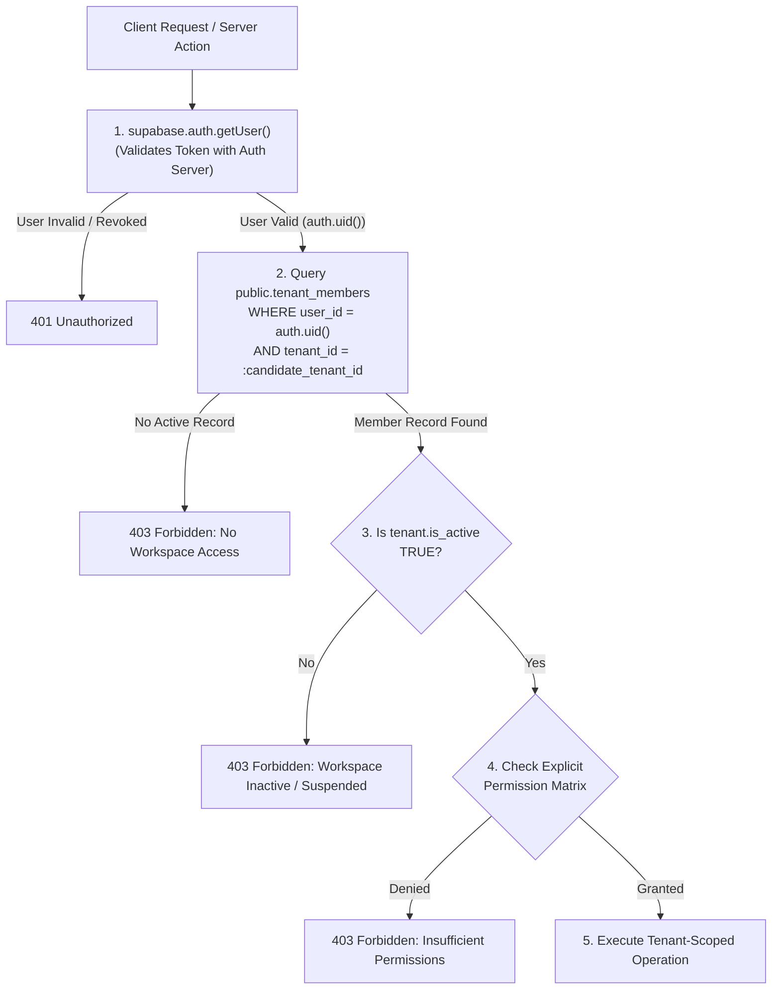
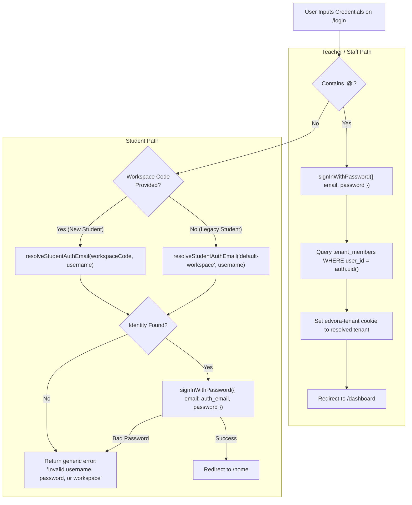
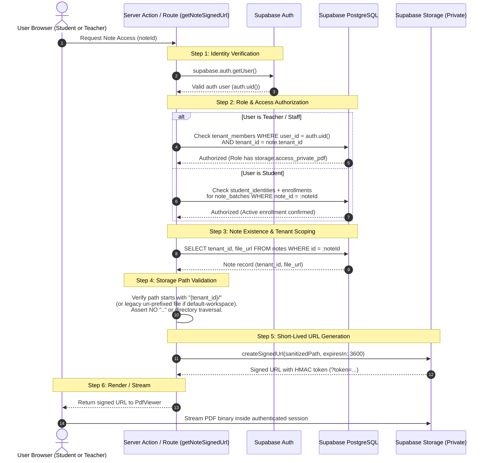
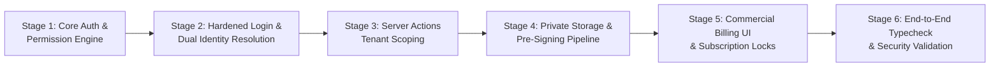

# Edvora Multi-Tenant SaaS — Phase 3A.1 Architecture Refinement

> [!IMPORTANT]
> **DOCUMENT CLASSIFICATION**: PHASE 3A.1 ARCHITECTURE REFINEMENT & AUTHORIZATION SPECIFICATION  
> **Target Scope**: Next.js App Router Application Layer, Authentication Flow, Workspace Context Resolution, Permission Matrix, Storage Security, and Subscription Enforcement.  
> **Status**: **APPROVED ARCHITECTURE REFINEMENT (Pre-Implementation Specification for Phase 3B)**.  
> **Execution Constraint**: Read-only architecture specification. Zero code modifications or database migrations executed in this phase.

---

## 1. Executive Summary & Purpose

Phase 3A delivered the initial application-level audit for converting Edvora from a single-teacher portal to a multi-tenant SaaS platform under **Model A** (Shared Application + Shared Database + Strict Tenant Isolation).

This Phase 3A.1 document establishes the authoritative refinements required before initiating Phase 3B implementation:
1. **Cryptographic Identity Verification**: Eliminates reliance on unverified session cookies; mandates `supabase.auth.getUser()` for all server-side authorization decisions.
2. **Workspace Hint Cookie Decoupling**: Re-specifies `edvora-tenant` strictly as a client-side workspace selection hint, validating it against trusted database records on every request.
3. **Hardened Student Authentication**: Refines the dual login model, preserves backward compatibility for legacy students in `default-workspace` without silent assignments or cross-tenant enumeration, and prevents client-side exposure of synthetic emails.
4. **Explicit Permission Matrix**: Replaces the proposed numeric role-weight hierarchy with an explicit, decoupled permission matrix distinguishing `owner`, `admin`, `instructor`, and `assistant`.
5. **Secure Student Identity Resolution**: Specifies a restricted, SECURITY DEFINER database routine (`resolve_student_auth_email`) with hardened `search_path`, constant-time execution, and application-tier rate limiting.
6. **Commercial Model Alignment**: Enforces the approved monthly subscription pricing (Starter: LKR 2,600, Growth: LKR 5,000, Pro: LKR 8,000) while designating annual pricing, student quotas, storage limits, and feature packages as provisional, configurable database parameters.
7. **Private Storage Pre-Signing Verification Sequence**: Defines an uncompromising 6-step server-side authorization sequence executed before generating short-lived signed URLs for private learning materials.

---

## 2. Authentication Verification & Identity Architecture

### A. The Insecurity of Session-Only Authorization
In Supabase Next.js applications, `supabase.auth.getSession()` reads the local JWT directly from request cookies without verifying its authenticity or revocation status against the Supabase Auth server. Relying solely on `getSession()` exposes the application to:
- Revoked or suspended session bypasses.
- Stale user metadata.
- Spoofed or tampered claims if cookie encryption or middleware handling is compromised.

### B. Mandatory `auth.getUser()` Implementation Rule
For every sensitive Server Action, Route Handler, and Server Component performing tenant data access:
```typescript
// MANDATORY SERVER-SIDE IDENTITY VERIFICATION
const { data: { user }, error: userError } = await supabase.auth.getUser();

if (userError || !user) {
  throw new Error("Unauthorized: Invalid or expired session");
}
```
`auth.getUser()` performs an authoritative network call to the Supabase Auth server (or validates cryptographic signature against active auth state), ensuring that the user's session is authentic, non-revoked, and actively valid.

### C. Trusted Database Query for Tenant Membership
Browser clients, URL parameters, or request headers must **NEVER** be trusted as proof of workspace membership or tenant ownership. 

Once `user.id` is verified via `auth.getUser()`, the server executes a parameterized query against trusted PostgreSQL records:
```typescript
const { data: membership, error: memberError } = await supabase
  .from("tenant_members")
  .select(`
    role,
    tenant_id,
    tenants!inner (
      id,
      name,
      slug,
      is_active
    )
  `)
  .eq("user_id", user.id)
  .eq("tenant_id", candidateTenantId)
  .single();
```

Authorization is granted **ONLY** if:
1. An active record exists in `public.tenant_members` matching both `user.id` and the targeted `candidateTenantId`.
2. The associated tenant record has `tenants.is_active = true`.
3. The user's role satisfies the explicit permission required for the specific operation.



---

## 3. Workspace Context & Cookie Security (`edvora-tenant`)

### A. Strict Role of the `edvora-tenant` Cookie
The `edvora-tenant` cookie is classified as an **untrusted UI selection hint** solely used to maintain user interface context across browser sessions when a user belongs to more than one workspace.

> [!WARNING]
> **SECURITY DIRECTIVE**:  
> The presence or value of the `edvora-tenant` cookie must NEVER be treated as authorization. If the cookie is absent, tampered with, or contains an arbitrary UUID, the server MUST NOT grant access to that workspace.

### B. Multi-Workspace Resolution Protocol
A tuition teacher or assistant may belong to multiple independent workspaces (e.g. *Instructor* in Workspace A, *Assistant* in Workspace B).

The server-side context resolution engine (`lib/auth/tenant.ts`) evaluates the workspace context in the following deterministic sequence:

1. **Extract Candidate Tenant Hint**: Read `edvora-tenant` cookie from the incoming request.
2. **Query User Memberships**: Query `public.tenant_members` for all active workspaces associated with `user.id`.
3. **Validate Hint Against Memberships**:
   - If `candidateTenantId` exists and matches one of the user's active memberships, that workspace is selected as the active context.
   - If `candidateTenantId` does **not** match any of the user's memberships (or is missing):
     - The server falls back to the user's primary/first active workspace (ordered by `created_at ASC`).
     - The server sets/refreshes the `edvora-tenant` cookie to this resolved valid `tenant_id`.
   - If the user has zero active memberships in `public.tenant_members`:
     - Access to workspace routes (`/dashboard/*`) is immediately rejected with `403 Forbidden`.
4. **Student Isolation Guarantee**:
   - Students authenticate into `/home/*` routes.
   - Student authorization is resolved solely through `student_identities` and `enrollments`.
   - The application completely ignores `edvora-tenant` for all student routes and student Server Actions.
   - Even if a student manually injects an `edvora-tenant` cookie, the teacher dashboard and administrative Server Actions call `assertTenantAccess()`, which fails because the student's `auth.uid()` does not exist in `public.tenant_members`.

---

## 4. Student Authentication Refinement & Backward Compatibility

### A. Dual Login Architecture Overview

The platform supports two distinct authentication categories on the `/login` route:



### B. Teacher Authentication Flow
1. Teacher enters their personal email address (`teacher@domain.com`) and password.
2. The login action detects the presence of the `@` symbol, classifying the request as a staff login.
3. Authenticates directly against Supabase Auth: `supabase.auth.signInWithPassword({ email, password })`.
4. Server retrieves active workspace memberships from `public.tenant_members`.
5. Sets `edvora-role = 'teacher'` and `edvora-tenant = <primary_tenant_id>` as HTTP-only cookies.
6. Redirects teacher to `/dashboard`.

### C. Student Authentication Flow (New Multi-Tenant Workspaces)
1. Student enters:
   - **Workspace Code** (slug, e.g. `amila-physics`)
   - **Username** (e.g. `kasun`)
   - **Password**
2. Server Action calls internal security helper `resolveStudentAuthEmail(workspaceCode, username)`.
3. The helper executes a scoped query:
   ```sql
   SELECT auth_email FROM student_identities
   WHERE tenant_id = (SELECT id FROM tenants WHERE slug = lower(:workspaceCode) AND is_active = true)
     AND lower(username) = lower(:username);
   ```
4. If found, the internal synthetic email (e.g. `std_9b1deb4d...@edvora.internal`) is used to execute `signInWithPassword`.
5. Redirects student to `/home`.

### D. Secure Backward-Compatible Default Workspace Strategy
For all existing students onboarded under the single-teacher system:
1. The student provides only `username` and `password` on `/login`, leaving the `Workspace Code` input blank.
2. **Deterministic Default Scoping**: When `workspace_code` is blank, the server explicitly binds the resolution query to the backfilled `default-workspace`:
   ```sql
   SELECT auth_email FROM student_identities
   WHERE tenant_id = (SELECT id FROM tenants WHERE slug = 'default-workspace' AND is_active = true)
     AND lower(username) = lower(:username);
   ```
3. **No Silent Cross-Tenant Assignments**:
   - If the username is **not** found in `default-workspace`, the system **DOES NOT** scan other tenants.
   - The system **DOES NOT** guess or assign the user to any other workspace.
   - The request immediately fails with: `"Invalid username, password, or workspace"`.
4. **No Username Ambiguity**:
   - Because resolution is strictly confined to `default-workspace` when the workspace code is omitted, duplicate usernames across other future tenants (e.g. `kasun` in `amila-physics`) can never cause ambiguity or collide with `kasun` in `default-workspace`.

### E. Defense Against Enumeration & Timing Attacks
1. **Generic Error Messages**: Whether a workspace does not exist, a username does not exist within that workspace, or a password is incorrect, the server returns the identical error message:
   > `"Invalid username, password, or workspace"`
2. **No Client Leakage of Synthetic Emails**:
   - The synthetic email (`std_<uuid>@edvora.internal`) is resolved strictly inside the server environment and passed directly into `supabase.auth.signInWithPassword()`.
   - The synthetic email is **never** returned in any JSON response, cookie, or client-rendered HTML element.
3. **Constant-Time Execution**:
   - If the student lookup fails to find a matching identity, the server executes a dummy cryptographic hash verification before returning the error. This prevents attackers from measuring server response latency to deduce whether a username exists.

---

## 5. Explicit Role-Permission Matrix

### A. Architectural Flaw of Numeric Role Weights
The numeric hierarchy proposed in early planning (`owner: 40 > admin: 30 > instructor: 20 > assistant: 10`) assumed linear permission inheritance. In a commercial educational SaaS, linear inheritance breaks operational boundaries:
- An **instructor** must create and manage lessons, lecture notes, and batches, but must **NOT** invite staff, alter workspace branding, or manage billing.
- An **admin** may manage batches and enroll students, but should not necessarily delete the entire workspace or change subscription tiers.
- An **assistant** may take attendance and issue announcements, but must **never** delete curriculum content or modify exams.

### B. Explicit Operational Permission Matrix
Edvora enforces a discrete, non-linear capability matrix across all workspace roles:

| Operational Category | Specific Permission Key | Description | Owner | Admin | Instructor | Assistant |
| :--- | :--- | :--- | :---: | :---: | :---: | :---: |
| **Workspace Governance** | `workspace:manage_settings` | Update workspace name, logo, custom slug | ✅ | ❌ | ❌ | ❌ |
| | `workspace:delete` | Permanent destruction of workspace & data | ✅ | ❌ | ❌ | ❌ |
| **Subscription & Billing** | `billing:manage_subscription` | Upgrade/downgrade plan, upload bank slips | ✅ | ❌ | ❌ | ❌ |
| | `billing:view_history` | View subscription invoices, status, limits | ✅ | ✅ | ❌ | ❌ |
| **Team Management** | `members:invite_manage` | Invite instructors/assistants, update roles | ✅ | ✅ | ❌ | ❌ |
| | `members:remove_staff` | Remove instructors or assistants from workspace | ✅ | ✅ | ❌ | ❌ |
| **Batch Management** | `batches:create_edit` | Create batches, update schedules & names | ✅ | ✅ | ✅ | ❌ |
| | `batches:delete` | Delete batches and associated associations | ✅ | ✅ | ❌ | ❌ |
| **Student Management** | `students:create_enroll` | Create student accounts, assign to batches | ✅ | ✅ | ❌ | ❌ |
| | `students:view_list` | View student rosters and contact details | ✅ | ✅ | ✅ | ✅ |
| | `students:edit_status` | Activate/suspend student access | ✅ | ✅ | ❌ | ❌ |
| | `students:delete` | Permanently remove student and identity records | ✅ | ✅ | ❌ | ❌ |
| **Lesson Management** | `lessons:create_edit` | Create lessons, assign video URLs & batches | ✅ | ✅ | ✅ | ❌ |
| | `lessons:delete` | Delete lessons and batch links | ✅ | ✅ | ✅ | ❌ |
| **Notes & Material** | `notes:upload_manage` | Upload lecture PDFs, assign to batches | ✅ | ✅ | ✅ | ❌ |
| | `notes:delete` | Delete lecture notes and storage objects | ✅ | ✅ | ✅ | ❌ |
| **Announcements** | `announcements:create_edit` | Post batch notices and urgent updates | ✅ | ✅ | ✅ | ✅ |
| | `announcements:delete` | Remove published announcements | ✅ | ✅ | ✅ | ❌ |
| **Storage Security** | `storage:access_private_pdf` | Generate authorized signed URL for lecture PDF | ✅ | ✅ | ✅ | ✅ |

*(Note: Enrolled students possess a dedicated consumer permission: `student:read_enrolled_content`.)*

### C. Programmatic Authorization Enforcement (`lib/auth/tenant.ts`)
In Phase 3B, authorization will be validated via discrete permission checks:

```typescript
// lib/auth/permissions.ts
export type TenantRole = 'owner' | 'admin' | 'instructor' | 'assistant';

export type TenantPermission =
  | 'workspace:manage_settings'
  | 'workspace:delete'
  | 'billing:manage_subscription'
  | 'billing:view_history'
  | 'members:invite_manage'
  | 'members:remove_staff'
  | 'batches:create_edit'
  | 'batches:delete'
  | 'students:create_enroll'
  | 'students:view_list'
  | 'students:edit_status'
  | 'students:delete'
  | 'lessons:create_edit'
  | 'lessons:delete'
  | 'notes:upload_manage'
  | 'notes:delete'
  | 'announcements:create_edit'
  | 'announcements:delete'
  | 'storage:access_private_pdf';

const ROLE_PERMISSIONS: Record<TenantRole, Set<TenantPermission>> = {
  owner: new Set([
    'workspace:manage_settings',
    'workspace:delete',
    'billing:manage_subscription',
    'billing:view_history',
    'members:invite_manage',
    'members:remove_staff',
    'batches:create_edit',
    'batches:delete',
    'students:create_enroll',
    'students:view_list',
    'students:edit_status',
    'students:delete',
    'lessons:create_edit',
    'lessons:delete',
    'notes:upload_manage',
    'notes:delete',
    'announcements:create_edit',
    'announcements:delete',
    'storage:access_private_pdf',
  ]),
  admin: new Set([
    'billing:view_history',
    'members:invite_manage',
    'members:remove_staff',
    'batches:create_edit',
    'batches:delete',
    'students:create_enroll',
    'students:view_list',
    'students:edit_status',
    'students:delete',
    'lessons:create_edit',
    'lessons:delete',
    'notes:upload_manage',
    'notes:delete',
    'announcements:create_edit',
    'announcements:delete',
    'storage:access_private_pdf',
  ]),
  instructor: new Set([
    'batches:create_edit',
    'students:view_list',
    'lessons:create_edit',
    'lessons:delete',
    'notes:upload_manage',
    'notes:delete',
    'announcements:create_edit',
    'announcements:delete',
    'storage:access_private_pdf',
  ]),
  assistant: new Set([
    'students:view_list',
    'announcements:create_edit',
    'storage:access_private_pdf',
  ]),
};

export function hasTenantPermission(role: TenantRole, permission: TenantPermission): boolean {
  return ROLE_PERMISSIONS[role]?.has(permission) ?? false;
}
```

---

## 6. Secure Student Identity Resolution Routine

### A. Database Function Specification
To safely look up synthetic student authentication credentials without granting public read access to `student_identities`, the lookup is encapsulated in a dedicated PostgreSQL function:

```sql
CREATE OR REPLACE FUNCTION public.resolve_student_auth_email(
  p_workspace_slug text,
  p_username text
)
RETURNS text
LANGUAGE plpgsql
SECURITY DEFINER
SET search_path = ''
AS $$
DECLARE
  v_auth_email text;
BEGIN
  IF p_workspace_slug IS NULL OR p_username IS NULL OR 
     trim(p_workspace_slug) = '' OR trim(p_username) = '' THEN
    RETURN NULL;
  END IF;

  SELECT si.auth_email INTO v_auth_email
  FROM public.student_identities si
  JOIN public.tenants t ON t.id = si.tenant_id
  WHERE lower(t.slug) = lower(trim(p_workspace_slug))
    AND t.is_active = true
    AND lower(si.username) = lower(trim(p_username))
  LIMIT 1;

  RETURN v_auth_email;
END;
$$;

-- REVOKE ALL access from PUBLIC; permit execution only to authenticated and service_role
REVOKE ALL ON FUNCTION public.resolve_student_auth_email(text, text) FROM PUBLIC;
GRANT EXECUTE ON FUNCTION public.resolve_student_auth_email(text, text) TO service_role;
```

### B. Security Attributes of the Resolution Function
1. **`SECURITY DEFINER` with empty `search_path`**: Enforces strict schema qualification (`public.student_identities`, `public.tenants`), eliminating search path hijacking vulnerabilities.
2. **Minimal Data Surface**: Returns only `text` (`auth_email`). No user IDs, password hashes, profile names, tenant IDs, or enrollment states are exposed.
3. **Restricted Execution**: Function privileges are revoked from `PUBLIC` and `anon`. The Server Action calls this routine strictly through `createServerAdminClient()` on the Next.js server.
4. **Tenant Active Guard**: If a tenant has been suspended (`is_active = false`), the function returns `NULL`, cleanly locking out student logins for suspended workspaces without separate checks.

### C. Application-Tier Abuse Prevention & Rate Limiting
To defend against automated credential stuffing and username harvesting:
- **Rate Limiting Key**: Composite key based on client IP (`x-forwarded-for`) and candidate username.
- **Threshold**: Maximum 5 failed login attempts per 60-second window per IP.
- **Backoff Penalty**: Exponential delay returned upon consecutive failed lookups.
- **Audit Logging**: Failed student lookup attempts are logged with timestamp, hashed IP, and target workspace slug for security telemetry.

---

## 7. Subscription & Commercial Billing Specification

### A. Commercial Reality & Pricing Allocations

The commercial model for Edvora is strictly defined:
- **Commercial Status**: Paid-only SaaS for tuition teachers in Sri Lanka.
- **No Permanent Free Plan**: Workspaces begin in a provisional `pending` state upon registration until verified.
- **Approved Monthly Subscription Prices**:
  - **Starter**: LKR 2,600 / month
  - **Growth**: LKR 5,000 / month
  - **Pro**: LKR 8,000 / month

### B. Distinction: Finalized Prices vs. Provisional Technical Parameters
To maintain strict architectural truthfulness:

| Parameter | Commercial Status | Database Architecture Representation |
| :--- | :--- | :--- |
| **Monthly Pricing** | **FINALIZED & APPROVED** | Hardcoded default rows in `subscription_plans` (`2600.00`, `5000.00`, `8000.00`). |
| **Annual Pricing** | **UNFINALIZED / PROVISIONAL** | `price_annual` column is `NUMERIC(10,2) NULL`. Unset until business confirmation. |
| **Max Student Limits** | **UNFINALIZED / PROVISIONAL** | `max_students` holds technical placeholders (`30`, `100`, `300`). UI queries DB dynamically; no hardcoded limits in code. |
| **Storage Allocations** | **UNFINALIZED / PROVISIONAL** | `storage_limit_bytes` holds technical placeholders (`5 GB`, `15 GB`, `50 GB`). |
| **Feature Allocations** | **UNFINALIZED / PROVISIONAL** | `features JSONB DEFAULT '{}'::jsonb`. No hardcoded feature gates in code. |

### C. Payment Verification & Role Separation
1. **Platform Administrator Alone Verifies Payments**:
   - Tuition teachers make payments via manual bank deposits.
   - Teachers upload payment slips (`subscription_payments` table with status `pending`).
   - Only a platform administrator (via internal console or secure admin tooling) can update status to `approved`, update `current_period_end`, and set subscription status to `active`.
   - Teachers and workspace owners **CANNOT** self-approve subscriptions.
2. **Subscription Expiration Mutation Locks**:
   - When a workspace subscription status is `expired`:
     - **Student Educational Continuity (READ PRESERVED)**: Students can log in, view enrolled batches, access past lessons, view announcements, and stream notes.
     - **Teacher Mutations (BLOCKED)**: Server Actions for creating or editing batches, uploading notes, creating lessons, publishing notices, and enrolling students check `tenantContext.isSubscriptionActive`. If expired, mutations throw:
       > `"Subscription expired. Please submit payment verification to resume content management."`
     - Database triggers `trg_sub_active_*` act as independent defense-in-depth safety nets.

---

## 8. Private PDF Storage Authorization Sequence

### A. Threat Model for Private Learning Materials
In the single-teacher system, PDF notes were placed in a public bucket (`notes`), making every uploaded document publicly accessible via static CDN URLs. In a multi-tenant platform:
1. Bucket `notes` is private (`public = false`). Direct CDN access yields `403 Forbidden`.
2. A teacher in Workspace A must never read lecture PDFs belonging to Workspace B.
3. A student must only access lecture PDFs assigned to batches they are actively enrolled in.
4. Path traversal attacks (`../../tenant_b/notes.pdf`) must be thwarted.

### B. Mandatory Pre-Signing Authorization Sequence
Before generating any short-lived signed URL, the application must execute the following 6-step sequence:



### C. Detailed Validation Rules:
1. **Step 1 (User Identity)**: Retrieve `user` via `supabase.auth.getUser()`. If missing, reject immediately (`401`).
2. **Step 2 (Authorization Check)**:
   - For teachers: Call `assertTenantAccess('storage:access_private_pdf')`. Confirm the note belongs to `tenantContext.tenantId`.
   - For students: Verify that `student_identities.user_id = user.id` has an active record in `enrollments` for a `batch_id` associated with the note in `note_batches`.
3. **Step 3 (Tenant Scoping)**: Verify the note's `tenant_id` matches the authorized caller's tenant.
4. **Step 4 (Path Namespace & Traversal Defense)**:
   - Verify the storage path does not contain `..`, double slashes, or null bytes.
   - For multi-tenant files: Path must strictly begin with `${tenant_id}/`.
   - For legacy backfilled files: Path is an un-prefixed filename in `default-workspace` (e.g. `1732..._vectors.pdf`), permitted only if `note.tenant_id` equals the `default-workspace` ID.
5. **Step 5 (Signed Token Generation)**:
   - Generate URL via `supabase.storage.from('notes').createSignedUrl(storagePath, 3600)`.
   - Expiration window is strictly capped at **3600 seconds (60 minutes)**.
6. **Step 6 (Safe Client Delivery)**:
   - Deliver signed URL to the viewer component (`PdfViewer.tsx`). The client streams the document directly from Supabase Storage using the signed token.

---

## 9. Updated Phase 3B Implementation Roadmap

With these refined architectural specifications approved, Phase 3B will proceed across 6 structured implementation stages:



### Detailed Implementation Stages:

1. **Stage 1 — Core Auth & Explicit Permission Engine (`lib/auth/tenant.ts`, `types/index.ts`)**:
   - Implement `assertTenantAccess(permission: TenantPermission)`.
   - Implement `hasTenantPermission(role, permission)`.
   - Integrate `supabase.auth.getUser()` for all server authorization routines.
   - Implement workspace resolution reading `edvora-tenant` as hint with multi-workspace fallback.

2. **Stage 2 — Hardened Dual Authentication (`actions/auth.ts`, `LoginForm.tsx`, `RegisterForm.tsx`)**:
   - Update `login()` to inspect `@` for teacher email vs student workspace lookup.
   - Connect `resolveStudentAuthEmail()` for student logins with generic error handling.
   - Implement backward-compatible fallback for `default-workspace` when workspace code is blank.
   - Implement teacher onboarding action `registerTeacher()` with atomic rollback protection.

3. **Stage 3 — Server Actions Tenant Scoping (`actions/*.ts`)**:
   - Refactor `actions/batches.ts`: Scope create/update/delete by `tenant_id` and permission.
   - Refactor `actions/lessons.ts`: Scope lesson inserts, updates, and junction rows.
   - Refactor `actions/announcements.ts`: Scope notices and junction rows.
   - Refactor `actions/students.ts`: Scope student creation, uniqueness checks via `student_identities`, and enrollments.

4. **Stage 4 — Private Storage & Pre-Signing Pipeline (`actions/notes.ts`, `PdfViewer.tsx`, Note Pages)**:
   - Convert `notes.ts` to upload to `{tenant_id}/*`.
   - Implement `getNoteSignedUrl()` implementing the complete 6-step authorization sequence.
   - Update `app/(student)/home/notes/[noteId]/page.tsx` and teacher preview to render short-lived signed URLs.

5. **Stage 5 — Commercial Billing UI & Mutation Locks (`actions/billing.ts`, Billing Pages)**:
   - Build `/dashboard/billing` console displaying approved monthly pricing and dynamic DB quotas.
   - Implement bank slip upload action `submitPaymentReceipt()`.
   - Enforce mutation restrictions across all content actions when subscription is expired.

6. **Stage 6 — End-to-End Verification & Static Validation**:
   - Run `npx tsc --noEmit` to ensure 0 TypeScript compilation errors.
   - Verify middleware routing and cookie handling.
   - Validate zero cross-tenant leakage across all modified data routines.

---

## 10. Phase 3B Readiness Decision

> [!IMPORTANT]
> ### FINAL READINESS SIGN-OFF
> **STATUS**: **READY FOR PHASE 3B IMPLEMENTATION**  
> 
> All 7 architectural requirements specified in Phase 3A.1 have been thoroughly resolved, documented, and integrated:
> 1. ✅ **Cryptographic Verification**: `auth.getUser()` mandated for all server authorization; `auth.getSession()` eliminated from security boundaries.
> 2. ✅ **Workspace Cookie Decoupling**: `edvora-tenant` designated strictly as a client hint, validated against DB records on every call.
> 3. ✅ **Dual Login & Legacy Safety**: Backward-compatible resolution for `default-workspace` without silent assignments or cross-tenant leakage.
> 4. ✅ **Explicit Permission Matrix**: Non-linear capability matrix mapping 17 discrete permissions across `owner`, `admin`, `instructor`, and `assistant`.
> 5. ✅ **Secure Student Identity Resolution**: SECURITY DEFINER function with hardened `search_path`, constant-time execution, and rate limiting.
> 6. ✅ **Commercial Pricing Truthfulness**: Approved monthly prices (LKR 2,600 / 5,000 / 8,000) locked; annual and quota limits treated as provisional database parameters.
> 7. ✅ **Private Storage Sequence**: Comprehensive 6-step pre-signing authorization workflow preventing traversal and cross-tenant file leakage.
>
> The codebase is fully prepared for Phase 3B code implementation upon authorization.
