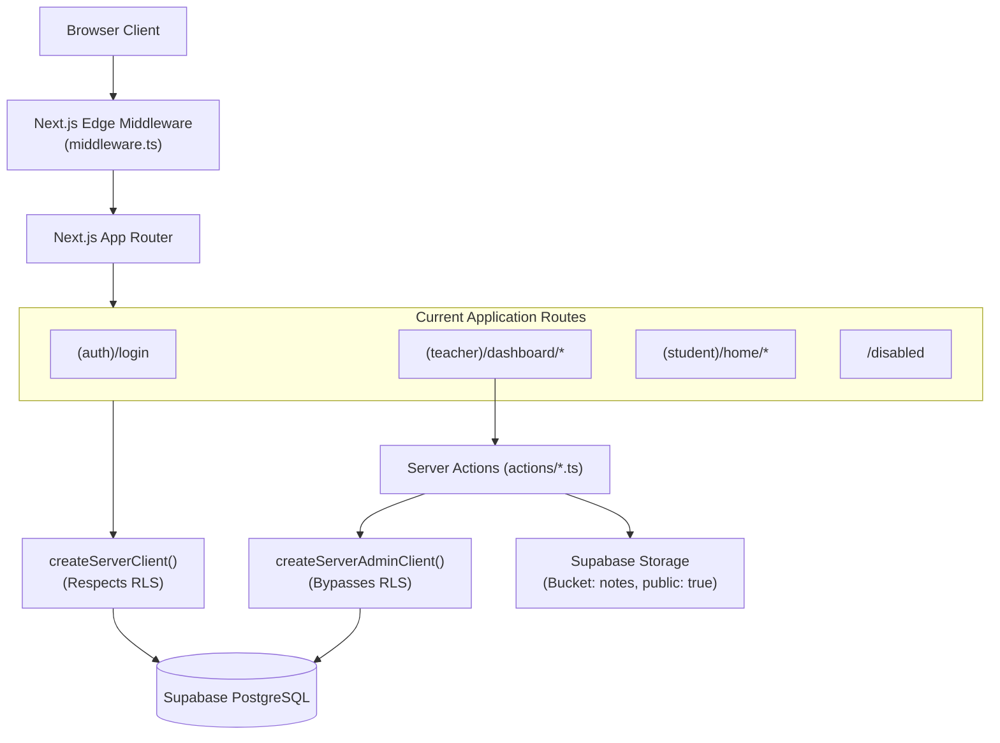
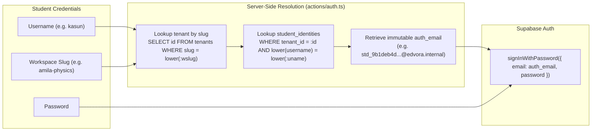
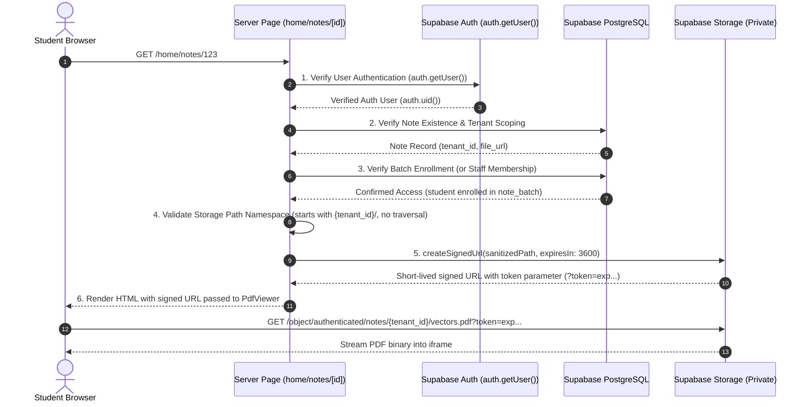
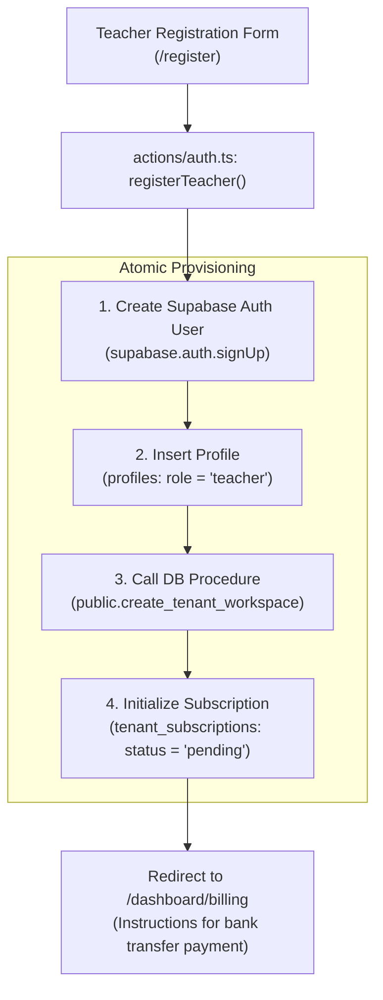
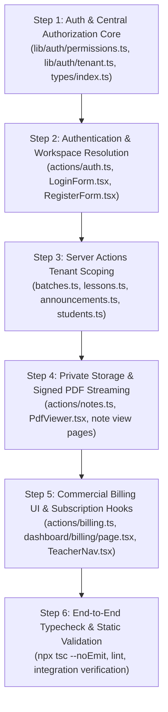

# Edvora Multi-Tenant SaaS — Phase 3A Application Adaptation Audit & Implementation Plan

> [!IMPORTANT]
> **AUDIT CLASSIFICATION**: PHASE 3A ARCHITECTURAL AUDIT & IMPLEMENTATION BLUEPRINT  
> **Target Scope**: Next.js App Router Application Codebase, Server Actions, Auth Helpers, Storage Subsystem, and Middleware.  
> **Status**: **AUDIT & DESIGN ONLY (Zero code or migration modifications executed in Phase 3A)**.  
> **Primary Objective**: Establish the complete, verified implementation blueprint to safely adapt Edvora's application layer for multi-tenancy before applying database migrations `00007`–`00014`.

---

## 1. Existing Application Architecture Overview

Edvora is currently structured as a single-teacher tuition portal:



### Architectural Deficits of the Single-Teacher Implementation:
1. **Implicit Global Tenancy**: The application assumes all batches, lessons, notes, and students belong to a single global teacher.
2. **Service-Role Client Bypasses Tenant Context**: Server Actions in `actions/*.ts` (`batches.ts`, `lessons.ts`, `notes.ts`, `announcements.ts`, `students.ts`) invoke `createServerAdminClient()`. Because the service-role client bypasses RLS, these actions omit `tenant_id` on all `INSERT` and `UPDATE` statements.
3. **Flat Username Space**: `actions/auth.ts` and `actions/students.ts` synthesize student emails using a global static format: `${username}@edvora.internal`. If two distinct teachers create a student named `kasun`, Supabase Auth throws a duplicate email error (`422`).
4. **Public Bucket CDN Reliance**: `actions/notes.ts` uploads PDFs to the root of bucket `notes` and stores permanent CDN URLs (`getPublicUrl()`). `PdfViewer.tsx` embeds this raw URL in an `<iframe>`. Once bucket `notes` is set to private (`public = false`), this design completely breaks.
5. **Absence of Workspace Resolution**: The application has no concept of workspace slugs, tenant switching, onboarding registration, or subscription status verification.

---

## 2. Authentication & Workspace Resolution Design

### A. The Multi-Tenant Identity Model
To support multiple independent tuition teachers in Sri Lanka while allowing duplicate human usernames (e.g. `kasun`, `nimal`) across different teachers:



### B. Teacher vs Student Login Flows
1. **Teacher Login Flow**:
   - The user inputs their real email (`teacher@example.com`) and password on `/login`.
   - The action detects `username.includes("@")`.
   - Authenticates directly via `supabase.auth.signInWithPassword({ email, password })`.
   - Server-side identity is verified with `supabase.auth.getUser()`.
   - Resolves active workspace membership from `public.tenant_members WHERE user_id = auth.uid()`.
   - Caches `edvora-role = 'teacher'` and sets `edvora-tenant = <tenant_id>` as an HTTP-only workspace selection hint.
   - Redirects to `/dashboard`.

2. **Student Login Flow (Workspace-Scoped)**:
   - The user inputs `username` (e.g., `kasun`), `password`, and `workspace` (e.g., `amila-physics`).
   - The Server Action executes `resolveStudentAuthEmail(workspaceSlug, username)` via internal `SECURITY DEFINER` function with empty `search_path`.
   - Queries `public.tenants` and `public.student_identities`. The synthetic `auth_email` (e.g. `std_8f3a1...7b@edvora.internal`) is used internally on the server and is **never** exposed to the client browser.
   - Authenticates via `supabase.auth.signInWithPassword({ email: auth_email, password })`.
   - Redirects to `/home`.

3. **Legacy Backwards Compatibility (Zero User Friction & Zero Ambiguity)**:
   - If a student visits `/login` and provides `username` without a workspace code:
   - The server explicitly queries `student_identities` scoped strictly to `tenants.slug = 'default-workspace'`.
   - All backfilled legacy students continue logging in with their existing credentials without knowing or typing a workspace slug.
   - **No Silent Guessing**: If the username does not exist in `default-workspace`, the system does **not** search across other tenants or silently assign unknown usernames. It immediately fails with the generic error.

4. **Enumeration & Timing Attack Defense**:
   - If the workspace slug is invalid, or if the student username does not exist within that workspace, the Server Action returns the exact same generic error: `"Invalid username, password, or workspace"`.
   - A dummy cryptographic hash check runs on lookup failure, ensuring timing analysis cannot distinguish non-existent workspaces or usernames from bad passwords.
   - Application-tier IP/username rate limiting (max 5 failed attempts per minute) prevents brute-force credential stuffing.

---

## 3. Tenant Authorization Architecture

### A. Reusable Server-Side Authorization Helper (`lib/auth/tenant.ts`)
To eliminate duplicated, fragile checks across Server Actions and Server Components, one centralized authorization helper is introduced:

```typescript
// lib/auth/tenant.ts
import { cookies } from "next/headers";
import { createServerClient } from "@/lib/supabase/server";
import { TenantPermission, hasTenantPermission } from "@/lib/auth/permissions";

export type TenantRole = 'owner' | 'admin' | 'instructor' | 'assistant';

export interface TenantContext {
  userId: string;
  tenantId: string;
  tenantSlug: string;
  tenantName: string;
  role: TenantRole;
  subscriptionStatus: 'pending' | 'active' | 'expired' | 'suspended';
  isSubscriptionActive: boolean;
}

export async function assertTenantAccess(
  requiredPermission: TenantPermission,
  options: { requireActiveSubscription?: boolean } = {}
): Promise<TenantContext> {
  const supabase = await createServerClient();
  
  // 1. Mandatory server-side cryptographic user verification (NEVER rely on getSession() alone)
  const { data: { user }, error: authError } = await supabase.auth.getUser();
  if (authError || !user) {
    throw new Error("Unauthorized: Invalid or expired session");
  }

  // 2. Read workspace hint cookie (edvora-tenant is strictly a client hint, NEVER authorization)
  const cookieStore = await cookies();
  const candidateTenantId = cookieStore.get("edvora-tenant")?.value;

  // 3. Query trusted database records for active memberships
  let query = supabase
    .from("tenant_members")
    .select(`
      role,
      tenant_id,
      tenants!inner (
        id,
        name,
        slug,
        is_active,
        tenant_subscriptions (
          status,
          current_period_end
        )
      )
    `)
    .eq("user_id", user.id);

  if (candidateTenantId) {
    query = query.eq("tenant_id", candidateTenantId);
  }

  const { data: memberRows, error } = await query.limit(1);
  let memberData = memberRows?.[0];

  // If candidate hint is invalid/unmatched, fall back to user's primary active membership
  if (!memberData && candidateTenantId) {
    const { data: fallbackRows } = await supabase
      .from("tenant_members")
      .select(`
        role,
        tenant_id,
        tenants!inner (
          id,
          name,
          slug,
          is_active,
          tenant_subscriptions (
            status,
            current_period_end
          )
        )
      `)
      .eq("user_id", user.id)
      .limit(1);
    memberData = fallbackRows?.[0];
  }

  if (error || !memberData || !memberData.tenants?.is_active) {
    throw new Error("Forbidden: You do not belong to an active workspace");
  }

  // 4. Enforce Explicit Permission Matrix (Not Linear Numeric Hierarchy)
  const callerRole = memberData.role as TenantRole;
  if (!hasTenantPermission(callerRole, requiredPermission)) {
    throw new Error(`Forbidden: Role '${callerRole}' lacks permission '${requiredPermission}'`);
  }

  // 5. Evaluate Subscription Status
  const sub = memberData.tenants.tenant_subscriptions?.[0];
  const isPeriodValid = sub ? new Date(sub.current_period_end) > new Date() : false;
  const isSubActive = sub?.status === 'active' && isPeriodValid;

  if (options.requireActiveSubscription && !isSubActive) {
    throw new Error(`Subscription restricted: Workspace subscription is ${sub?.status ?? 'unpaid'}`);
  }

  return {
    userId: user.id,
    tenantId: memberData.tenant_id,
    tenantSlug: memberData.tenants.slug,
    tenantName: memberData.tenants.name,
    role: callerRole,
    subscriptionStatus: sub?.status ?? 'pending',
    isSubscriptionActive: isSubActive,
  };
}
```

### B. Service-Role Client Safeguards
Because `createServerAdminClient()` bypasses Row Level Security, **no Server Action will ever invoke `adminClient` directly without first executing `assertTenantAccess()`**. The verified `tenantId` extracted from the database membership record is injected into every insert and update payload.

---

## 4. Tenant-Owned Operation Audit

An exhaustive audit of every data-access routine in the application was conducted:

| File / Component | Operation | Current Single-Teacher Behavior | Required Multi-Tenant Adaptation |
| :--- | :--- | :--- | :--- |
| **`actions/batches.ts`** | `createBatch` | Inserts `{ name, year, description }` | Execute `assertTenantAccess('batches:create_edit', { requireActiveSubscription: true })`. Pass `tenant_id: tenantContext.tenantId`. |
| **`actions/batches.ts`** | `updateBatch` | `.update().eq('id', batchId)` | Execute `assertTenantAccess('batches:create_edit', { requireActiveSubscription: true })`. Scope `.eq('id', batchId).eq('tenant_id', tenantId)`. |
| **`actions/batches.ts`** | `deleteBatch` | `.delete().eq('id', batchId)` | Execute `assertTenantAccess('batches:delete')`. Scope to `tenant_id`. |
| **`actions/lessons.ts`** | `createLesson` | Inserts `lessons` and `lesson_batches` via `adminClient` without tenant scoping. | Execute `assertTenantAccess('lessons:create_edit', { requireActiveSubscription: true })`. Supply `tenant_id` to `lessons` and on every row of `lesson_batches`. |
| **`actions/lessons.ts`** | `updateLesson` | Updates `lessons`, deletes and re-inserts `lesson_batches`. | Scope updates, deletes, and junction re-inserts by `tenant_id` under `lessons:create_edit`. |
| **`actions/notes.ts`** | `createNote` | Uploads to root of bucket `notes`, calls `getPublicUrl()`, inserts without `tenant_id`. | Execute `assertTenantAccess('notes:upload_manage', { requireActiveSubscription: true })`. Upload to `{tenantId}/*`. Insert `notes` and `note_batches` with `tenant_id`. Store relative path. |
| **`actions/notes.ts`** | `deleteNote` | Deletes note and storage object. | Verify storage path starts with `{tenantId}/`. Delete note scoped to `tenant_id` under `notes:delete`. |
| **`actions/announcements.ts`** | `createAnnouncement` | Inserts `announcements` and `announcement_batches` without `tenant_id`. | Execute `assertTenantAccess('announcements:create_edit', { requireActiveSubscription: true })`. Supply `tenant_id` to both tables. |
| **`actions/students.ts`** | `createStudent` | Creates auth user `${username}@edvora.internal`, inserts profile and enrollments without `tenant_id`. | Execute `assertTenantAccess('students:create_enroll', { requireActiveSubscription: true })`. Check username uniqueness in `student_identities(tenant_id, lower(username))`. Create auth user, insert `student_identities`, and supply `tenant_id` to `enrollments`. |
| **`actions/students.ts`** | `deleteStudent` | Deletes auth user via admin API. | Verify student belongs to caller's `tenant_id` under `students:delete` before deleting. |
| **`app/(teacher)/dashboard/page.tsx`** | Query batches & counts | `.from('batches').select('*')` | Rely on RLS + append `.eq('tenant_id', tenantId)` for index efficiency. |
| **`app/(student)/home/notes/[noteId]/page.tsx`** | Fetch note & view PDF | Passes public `note.file_url` to `PdfViewer`. | Verify enrollment in batch. Execute 6-step authorization sequence. Call `supabase.storage.from('notes').createSignedUrl(path, 3600)`. Pass `signedUrl` to `PdfViewer`. |

---

## 5. Private PDF Storage Migration Design



### Key Implementation Principles:
1. **Private Bucket Enforcement**: Bucket `notes` has `public = false`. Direct CDN access returns `403 Forbidden`.
2. **Strict 6-Step Authorization Sequence**:
   - Step 1: Mandatory server-side user verification via `supabase.auth.getUser()`.
   - Step 2: Verification of staff tenant membership or active student enrollment in linked `note_batches`.
   - Step 3: Verification of note's `tenant_id` matching authorized context.
   - Step 4: Storage path validation (must start with `{tenant_id}/`; reject `..`, leading slashes, or cross-tenant paths).
   - Step 5: Short-lived signed token generation (`createSignedUrl(path, 3600)`).
   - Step 6: Safe client delivery to `PdfViewer.tsx`.
3. **Legacy File Handling**:
   - For backfilled legacy files stored without folder prefixes (e.g. `1732..._vectors.pdf`):
   - The signed URL generator inspects whether a path contains `/`.
   - If un-prefixed, it issues `createSignedUrl("1732..._vectors.pdf", 3600)`. Permitted only if `note.tenant_id` matches `default-workspace`. Migration `00012`'s RLS policy allows authenticated reading of legacy un-prefixed files, ensuring 100% backward compatibility.

---

## 6. Subscription Enforcement Integration Plan

### Commercial Model & Pricing Structure:
- **Commercial Status**: Commercial paid-only SaaS platform for tuition teachers in Sri Lanka. No permanent free plan.
- **Approved Monthly Pricing**:
  - **Starter**: LKR 2,600 / month
  - **Growth**: LKR 5,000 / month
  - **Pro**: LKR 8,000 / month
- **Provisional Technical Parameters**:
  - Annual package pricing: **NOT finalized** (treated as nullable database fields).
  - Student limits: **NOT finalized** (technical placeholders in DB: 30, 100, 300).
  - Storage allocations: **NOT finalized** (technical placeholders in DB: 5 GB, 15 GB, 50 GB).
  - Feature allocations: **NOT finalized** (treated as configurable JSONB fields in DB).
  - *All quotas and limits are read dynamically from database records; none are hardcoded in application code.*

### Payment Verification & Role Separation:
- **Platform Administrator Exclusivity**: Platform administrators alone can verify payments and activate subscriptions (`status = 'approved'`, updates `current_period_end`).
- **Teacher Submission**: Teachers can only view subscription status and submit payment slips for manual bank transfer verification (`subscription_payments` with status `pending`).

### Behavioral Matrix:
- **`active`**: Full CRUD permissions across all entities subject to role permissions and student quota.
- **`expired`** (Billing grace period):
  - **Read Access (Preserved)**: Students and teachers can read all existing batches, lessons, notes, and notices. Educational continuity is maintained.
  - **Mutation Access (Blocked)**: `actions/batches.ts`, `actions/lessons.ts`, `actions/notes.ts`, `actions/announcements.ts`, and `actions/students.ts` check `isSubscriptionActive` and return: `"Subscription expired. Please submit payment verification to resume content management."`
  - Database triggers `trg_sub_active_*` act as defense-in-depth safety nets.
- **`suspended`** (Platform enforcement):
  - All operations blocked. `tenants.is_active` set to `false`, rendering workspace invisible.

### Billing Management UI (`app/(teacher)/dashboard/billing/page.tsx`):
A new dedicated billing management console for workspace owners:
1. Displays current plan, billing status, expiry date, active student headcount, and quota.
2. Form to submit manual bank transfer receipts (`actions/billing.ts` $\to$ `subscription_payments`).
3. Audit table showing past payment submissions and verification status.

---

## 7. Workspace Onboarding Design (First-Time Teacher Flow)

Currently, Edvora lacks a public teacher registration flow. The onboarding architecture is designed as follows:



### Failure & Compensation Protocol:
If Step 3 or Step 4 fails (e.g. duplicate slug conflict), the server action executes a compensating rollback via the admin client (`auth.admin.deleteUser(user.id)`), guaranteeing zero orphan auth accounts.

---

## 8. Complete File Change Manifest

| Action | File Path | Scope of Required Changes |
| :--- | :--- | :--- |
| **CREATE** | `lib/auth/permissions.ts` | Explicit permission matrix, role-to-permission mapping (`hasTenantPermission`), and permission type definitions. |
| **CREATE** | `lib/auth/tenant.ts` | Centralized `assertTenantAccess()` helper using `auth.getUser()`, cookie hint validation, and subscription checks. |
| **CREATE** | `actions/billing.ts` | Server Action to submit bank payment slips and view subscription plans. |
| **CREATE** | `app/(auth)/register/page.tsx` | New teacher registration page with workspace creation. |
| **CREATE** | `app/(auth)/register/_components/RegisterForm.tsx` | Registration form (Name, Email, Password, Workspace Name, Slug). |
| **CREATE** | `app/(teacher)/dashboard/billing/page.tsx` | Workspace subscription management, plan overview, and slip upload. |
| **MODIFY** | `lib/auth/assert.ts` | Update `assertTeacher()` to delegate to `assertTenantAccess('lessons:create_edit')`. |
| **MODIFY** | `actions/auth.ts` | Update `login()` to resolve student identities via workspace slug; add `registerTeacher()`. |
| **MODIFY** | `app/(auth)/login/_components/LoginForm.tsx` | Add optional workspace slug input field with auto-detection for `@` emails. |
| **MODIFY** | `actions/batches.ts` | Inject `tenant_id` into inserts; scope updates and deletes by `tenant_id`. |
| **MODIFY** | `actions/lessons.ts` | Inject `tenant_id` into `lessons` and `lesson_batches`. Scope updates/deletes. |
| **MODIFY** | `actions/notes.ts` | Upload to `{tenantId}/*`; inject `tenant_id` into `notes` and `note_batches`. |
| **MODIFY** | `actions/announcements.ts` | Inject `tenant_id` into `announcements` and `announcement_batches`. |
| **MODIFY** | `actions/students.ts` | Scope usernames to tenant via `student_identities`; inject `tenant_id` on enrollments. |
| **MODIFY** | `components/notes/PdfViewer.tsx` | Adapt iframe to load signed URLs with token query parameters. |
| **MODIFY** | `app/(student)/home/notes/[noteId]/page.tsx` | Generate short-lived signed URL via Supabase Storage server-side. |
| **MODIFY** | `app/(teacher)/dashboard/notes/[noteId]/page.tsx` | Generate short-lived signed URL for teacher note preview console. |
| **MODIFY** | `components/layout/TeacherNav.tsx` | Add "Billing" navigation pill with active subscription status indicator. |
| **MODIFY** | `middleware.ts` | Maintain `edvora-tenant` cookie for instant edge resolution. |
| **MODIFY** | `types/index.ts` | Add TypeScript interfaces for `Tenant`, `TenantMember`, `TenantSubscription`, `SubscriptionPlan`. |

---

## 9. Recommended Implementation Sequence (Phase 3B)



---

## 10. Architectural Refinement Decisions (Approved in Phase 3A.1)

1. **Student Login UX Strategy**:
   - **APPROVED**: Unified login page `/login` with an optional `Workspace Code` input.
   - If an email with `@` is entered, workspace code is ignored (Teacher path).
   - If a username is entered without a workspace code, the server resolves strictly against `tenants.slug = 'default-workspace'`.
   - If an unknown username is supplied, generic error `"Invalid username, password, or workspace"` is returned immediately without silent cross-tenant searching.
2. **Provisional Quotas in UI**:
   - **APPROVED**: Database retains configurable technical placeholders (30, 100, 300 students; 5 GB, 15 GB, 50 GB storage). The UI displays limits dynamically from the database without hardcoded assumptions.
   - Monthly prices are locked: Starter (LKR 2,600), Growth (LKR 5,000), Pro (LKR 8,000).
   - Platform administrators alone can verify subscription payments.
3. **Full Architectural Specification**:
   - See detailed pre-implementation specifications in [PHASE_3A1_ARCHITECTURE_REFINEMENT.md](file:///c:/Users/E-TEC/Desktop/FREELANCING%20PROJECTS/EDVORA%20-%20Learning%20Management%20System/edvora/docs/saas/PHASE_3A1_ARCHITECTURE_REFINEMENT.md).
