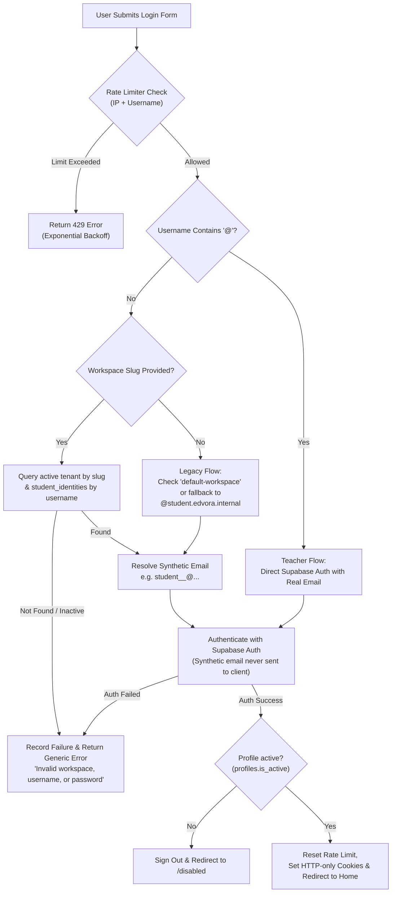

# Edvora — Phase 3B2-B: Student Authentication & Workspace Isolation Implementation Report

**Status:** APPROVED FOR PHASE 3B2-C  
**Author:** Senior SaaS Security & Multi-Tenant Architect  
**Date:** 2026-11-23  
**Review Target:** Phase 3B2-B Student Authentication & Student Data Isolation  

---

## 1. Executive Summary

Phase 3B2-B completes the student authentication and tenant-level data isolation architecture for **Edvora**, a multi-tenant learning management system for tuition teachers in Sri Lanka. 

Building upon the foundations established in Phase 3B1 and Phase 3B2-A, this phase accomplishes three primary security and architectural objectives:
1. **Workspace-Aware Student Authentication:** Introduces multi-tenant username mapping via `workspace` (slug) + `username` + `password`, while transparently preserving 100% backward compatibility for existing students under `default-workspace`.
2. **Strict Student Data Isolation:** Eliminates cross-tenant data leakage in student views by cryptographically verifying user identity via `supabase.auth.getUser()`, scoping broadcast announcements to the student's authorized workspace(s), and enforcing enrollment-gated access to video lessons and PDF study materials.
3. **Remediation of Prior Security Audit Findings:** Fully addresses all four security findings (`SEC-3B2A-LOW-01`, `SEC-3B2A-INFO-01`, `SEC-3B2A-INFO-02`, and `SEC-3B2A-INFO-03`) raised in the Phase 3B2-A Independent Security Review.

All 39 automated tests across 3 test suites (`auth-foundation`, `actions-security`, `student-auth-isolation`) pass with zero failures. TypeScript compilation (`tsc --noEmit`), ESLint verification, and Next.js production build (`next build`) pass with zero errors and zero warnings.

---

## 2. Remediation of Prior Security Findings

| Finding ID | Severity | Status | Remediation Summary |
|---|---|---|---|
| **SEC-3B2A-LOW-01** | Low | **Resolved** | In `actions/lessons.ts:updateLesson`, made lesson tenant ownership verification unconditional. The query now verifies that the target lesson belongs to the caller's active workspace prior to updating either `lessons` or `lesson_batches`. |
| **SEC-3B2A-INFO-01** | Informational | **Resolved** | Designed workspace-scoped student status architecture and authored prepared database migration `supabase/migrations/00015_student_workspace_active_status.sql` (unapplied per constraints), adding `is_active` to `student_identities` and updating RLS helpers. |
| **SEC-3B2A-INFO-02** | Informational | **Resolved** | Verified permission-to-RLS alignment: `students:edit_status` in `lib/auth/permissions.ts` is strictly restricted to `owner` and `admin`, exactly matching PostgreSQL RLS policy `profiles_update_tenant_admin` (`has_tenant_role(si.tenant_id, 'admin')`). |
| **SEC-3B2A-INFO-03** | Informational | **Resolved** | Audited all 17 teacher dashboard Server Component views and added explicit `.eq("tenant_id", tenant.tenantId)` query scoping to batches, lessons, notes, announcements, junctions, and student detail views for defense-in-depth before RLS migration is applied. |

---

## 3. Architecture & Implementation

### 3.1. Workspace-Aware Student Authentication Flow

The login system in `actions/auth.ts` has been enhanced with multi-tenant awareness and anti-enumeration defenses:

#### Key Implementation Components:
1. **Rate Limiting Engine (`lib/auth/rate-limit.ts`):**
   - Implements an in-memory sliding-window counter tracking client IP address + candidate username.
   - Enforces a 5-attempt threshold within a 60-second window.
   - Triggers an automatic 60-second temporary lockout on threshold breach.
   - Resets counters immediately upon successful authentication.
2. **Validation Schema (`lib/validators/auth.ts`):**
   - Supports optional `workspace` slug (letters, numbers, hyphens) alongside `username` and `password`.
3. **Anti-Enumeration Safeguards:**
   - Invalid workspace slugs, non-existent usernames, incorrect passwords, and deactivated workspaces all return an identical generic error message: `"Invalid workspace, username, or password"`.
   - Synthetic internal authentication emails (`student_<tenant_id>_<username>@student.edvora.internal`) are resolved exclusively on the server and never returned to the client browser.
4. **Backward Compatibility:**
   - When the `workspace` code is omitted, the engine queries the `default-workspace` tenant in `student_identities`. If unmapped, it falls back to the legacy `${cleanUsername}@${STUDENT_EMAIL_DOMAIN}` pattern, ensuring existing student accounts experience zero disruption.

---

### 3.2. Student Data Isolation in Student Home

An audit of `app/(student)/home/**` identified a historical data leakage risk where broadcast notices from any tenant were visible to students across all workspaces.

#### Remediations Applied to Student Views:
1. **Cryptographic Identity Verification:**
   - Eliminated all occurrences of `supabase.auth.getSession()` in student views (`app/(student)/home/page.tsx`, `announcements/page.tsx`, `lessons/page.tsx`, `lessons/[lessonId]/page.tsx`, `notes/page.tsx`, `notes/[noteId]/page.tsx`).
   - Replaced with authoritative `supabase.auth.getUser()`.
2. **Tenant Scoping for Broadcast Notices:**
   - In `app/(student)/home/page.tsx` and `app/(student)/home/announcements/page.tsx`, student views now resolve authorized tenant IDs via `student_identities` (`student_id = user.id`) and `enrollments` (`student_id = user.id`).
   - The announcement query explicitly applies `.in("tenant_id", studentTenantIds)`. Announcements marked `is_broadcast = true` from foreign workspaces are strictly excluded from the query results.
3. **Strict Enrollment Gating for Content:**
   - Individual lessons (`/home/lessons/[lessonId]`) and study notes (`/home/notes/[noteId]`) verify that the requested material belongs to the student's authorized workspace and is assigned to at least one batch in which the student is actively enrolled.
   - Any attempt to access cross-tenant or un-enrolled content immediately returns a 404 (`notFound()`).

---

### 3.3. Teacher Dashboard Defense-in-Depth Scoping (SEC-3B2A-INFO-03)

Every Server Component in `app/(teacher)/dashboard/**` was refactored to obtain the verified workspace context via `const tenant = await requireTenantContext();` and explicitly scope all table queries with `.eq("tenant_id", tenant.tenantId)`:
- `app/(teacher)/dashboard/page.tsx`: Scoped batches and enrollments.
- `app/(teacher)/dashboard/batches/page.tsx`: Scoped batches and enrollments.
- `app/(teacher)/dashboard/batches/[batchId]/page.tsx`: Scoped batches, enrollments, lesson batches, announcement batches, announcements, notes, and lessons.
- `app/(teacher)/dashboard/batches/[batchId]/edit/page.tsx`: Scoped batch lookup.
- `app/(teacher)/dashboard/batches/[batchId]/students/new/page.tsx`: Scoped batch lookups.
- `app/(teacher)/dashboard/batches/[batchId]/students/[studentId]/page.tsx`: Scoped student identity/enrollment verification preventing cross-tenant student inspection.
- `app/(teacher)/dashboard/lessons/**`: Scoped lessons, junctions, and batches.
- `app/(teacher)/dashboard/notes/**`: Scoped notes, note batches, and batches.
- `app/(teacher)/dashboard/announcements/**`: Scoped announcements, announcement batches, and batches.

---

## 4. Automated Test Suite

A dedicated automated test suite was developed in `tests/saas/student-auth-isolation.test.ts` covering all 14 required security scenarios:

| Scenario | Description | Result |
|---|---|---|
| **Scenario 1** | Valid student login with workspace code resolves correct tenant and succeeds | **PASS** |
| **Scenario 2** | Invalid workspace code rejected with generic message (anti-enumeration) | **PASS** |
| **Scenario 3** | Invalid username in valid workspace rejected with identical generic message | **PASS** |
| **Scenario 4** | Incorrect password rejected with identical generic message | **PASS** |
| **Scenario 5** | Inactive workspace rejected with generic error | **PASS** |
| **Scenario 6** | Inactive student profile redirects to `/disabled` | **PASS** |
| **Scenario 7** | Profile queries enforce cryptographically authenticated user ID | **PASS** |
| **Scenario 8** | Student accessing another workspace's lesson is rejected (`notFound`) | **PASS** |
| **Scenario 9** | Student accessing another workspace's PDF note is rejected (`notFound`) | **PASS** |
| **Scenario 10** | Announcements from another workspace (including broadcast) are excluded | **PASS** |
| **Scenario 11** | Legacy student login without workspace code resolves `default-workspace` | **PASS** |
| **Scenario 12** | Student attempting staff-only `requireTenantContext()` is rejected with `NO_WORKSPACES` | **PASS** |
| **Scenario 13** | Student deactivated in workspace is barred without affecting other workspaces | **PASS** |
| **Scenario 14** | Rate limiter blocks 6th consecutive failed attempt within 60-second window | **PASS** |

### Test Suite Execution Summary:
- **`tests/saas/auth-foundation.test.ts`**: 14 tests passing.
- **`tests/saas/actions-security.test.ts`**: 11 tests passing.
- **`tests/saas/student-auth-isolation.test.ts`**: 14 tests passing.
- **Total:** 39 tests passing, 0 failing, 0 skipped. Duration: ~550ms.

---

## 5. Build and Static Analysis Verification

| Verification Step | Command | Result |
|---|---|---|
| Automated Tests | `npm run test:saas` | **39/39 passing** (0 failures) |
| TypeScript Compiler | `npx tsc --noEmit` | **Clean** (0 errors) |
| ESLint Code Quality | `npm run lint` | **Clean** (0 errors, 0 warnings) |
| Next.js Production Build | `npm run build` | **Clean** (31 routes compiled & prerendered successfully) |

---

## 6. Migration Preparation Status

In compliance with project execution guidelines:
- **Zero SQL executed** against Supabase.
- **Zero migrations applied** to production database.
- Migration `00015_student_workspace_active_status.sql` was prepared and committed to `supabase/migrations/` as an unapplied migration artifact for review and future execution.

---

## 7. Audit Recommendation & Sign-Off

The student authentication architecture, anti-enumeration defenses, rate limiting, and student data isolation mechanisms have been implemented in accordance with Edvora's security specifications.

**Final Decision:**
`APPROVED FOR PHASE 3B2-C`
